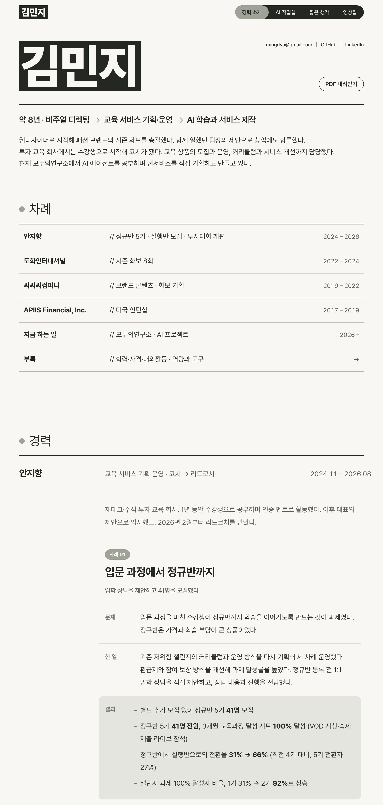
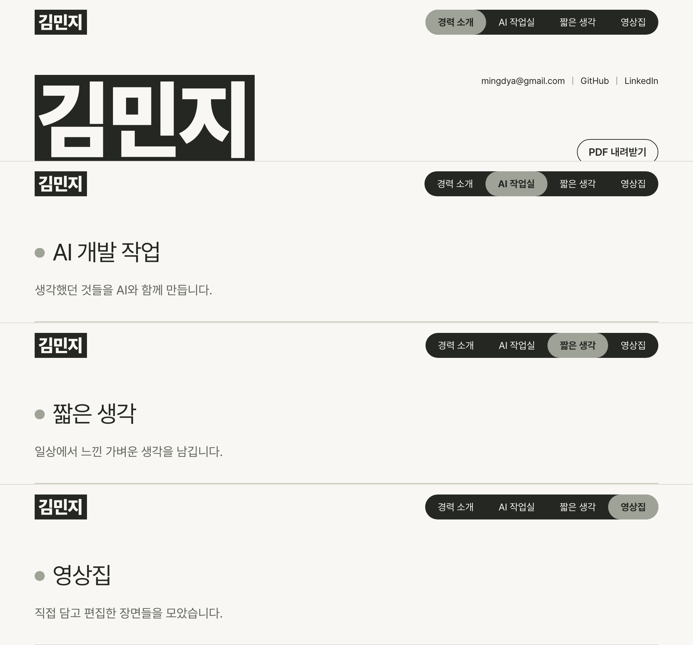
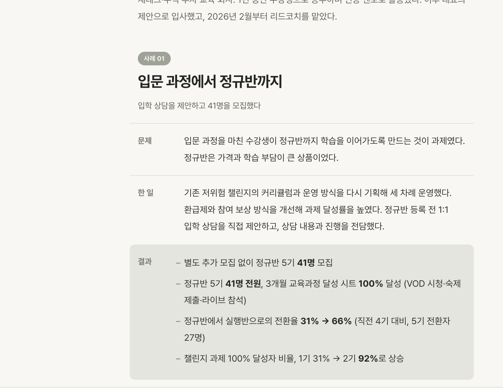

  <iframe src="https://k-im-rose.github.io/" title="나만의 웹 포트폴리오 메인 페이지" loading="lazy"></iframe>

<a href="https://k-im-rose.github.io/" target="_blank" rel="noopener">웹사이트 보기</a> · <a href="https://github.com/k-im-rose/k-im-rose.github.io" target="_blank" rel="noopener">GitHub 보기</a>

## 1. 어떤 문제에서 시작했나?

새로운 일을 준비하면서 이력서와 포트폴리오를 만들어야 했다.

그런데 일반적인 이력서 양식에 내 경험을 정리하는 것이 조금 아쉬웠다. 웹디자인으로 일을 시작해 패션 브랜드의 비주얼 디렉팅을 맡았고, 이후 교육 서비스 기획과 운영까지 경험했다. 직무가 여러 번 바뀐 만큼 단순히 회사와 담당 업무를 나열하는 것만으로는 나를 충분히 설명하기 어려웠다.

무엇보다 디자인을 해왔던 사람으로서 내 이력서만큼은 정해진 양식에서 벗어나 자유롭게 만들어 보고 싶었다.

그러다 AI로 웹사이트를 만들 수 있다는 것을 배우면서, **이력서 자체를 하나의 웹사이트로 만들어 보면 어떨까?** 하는 생각이 들었다.

## 2. 사용하는 사람은 누구인가?

우선 나를 처음 만나는 채용담당자를 생각했다.

내가 어떤 일을 해왔는지, 그 과정에서 무엇을 맡았고 어떤 결과를 만들었는지 쉽게 이해할 수 있어야 했다.

이력서를 처음부터 끝까지 읽지 않더라도 중요한 경력과 성과를 빠르게 파악할 수 있도록 만들고 싶었다. 관심이 생긴 부분은 더 자세히 살펴볼 수 있는 구조도 필요했다.

동시에 이력서 한 장으로는 보여주기 어려운 것도 담고 싶었다. 직접 만든 결과물이나 평소의 생각, 디자인 작업처럼 나를 조금 더 입체적으로 보여줄 수 있는 내용이다.

그래서 이력서를 중심에 두되, 관심 있는 사람은 다른 작업까지 자유롭게 살펴볼 수 있는 구조로 만들기로 했다.

## 3. 어떻게 해결했나?

### 경력을 나열하기보다, 일한 방식을 보여주기

가장 먼저 경력 소개 페이지를 만들었다.

회사별로 담당 업무를 나열하는 대신, 주요 프로젝트를 문제와 실행, 결과 중심으로 정리했다.

교육 서비스에서 수강생을 모집한 과정, 참여 규칙을 개선한 경험, 패션 브랜드의 화보를 기획하고 제작한 경험 등을 구체적으로 담았다.

가능한 부분은 숫자로 성과를 보여주고, 처음 보는 사람도 이해할 수 있도록 낯선 용어나 긴 설명은 줄였다.

내가 어떤 직함을 가졌는지보다 **어떤 문제를 맡아 어떻게 해결했는지** 보여주고 싶었다.

<figure class="shot">
  
  <figcaption>메인 경력 소개 화면. 이름과 커리어 흐름을 먼저 보여주고, 주요 프로젝트는 문제·한 일·결과 순서로 정리했다.</figcaption>
</figure>

### 이력서에서 개인 웹사이트로 확장하기

처음에는 경력을 소개하는 것이 목적이었지만, 사이트를 만들면서 보여주고 싶은 내용이 늘어났다.

그렇게 네 가지 카테고리로 확장했다.

| 카테고리 | 담은 내용 |
|---|---|
| 경력 소개 | 경력과 주요 프로젝트, 성과 |
| AI 작업실 | AI로 기획하고 만든 작업과 제작 과정 |
| 짧은 생각 | 일상에서 느낀 생각과 개인적인 글 |
| 영상집 | 직접 촬영하고 편집한 영상 |

<figure class="shot">
  
  <figcaption>경력 소개, AI 작업실, 짧은 생각, 영상집 네 페이지의 상단. 모든 페이지에서 같은 메뉴가 보인다.</figcaption>
</figure>

특히 AI 작업실은 새로운 프로젝트가 생길 때마다 추가할 수 있도록 만들었다.

짧은 생각에는 평소에 쓰던 글을, 영상집에는 직접 만든 영상을 넣었다. 별도의 포트폴리오를 여러 개 준비하지 않아도 하나의 사이트에서 내 경험과 작업을 함께 볼 수 있게 된 것이다.

### 읽는 사람을 생각한 디자인

디자인에서 가장 중요하게 생각한 것은 가독성이었다.

처음 방문한 사람이 복잡하다는 느낌 없이 편안하게 읽을 수 있었으면 했다. 평소에도 간결한 디자인을 좋아하지만, 이번에는 특히 정보를 전달하는 목적에 맞게 구성하고 싶었다.

그래서 장식적인 요소를 줄이고 글과 여백을 중심으로 디자인했다.

모든 내용을 같은 크기와 무게로 보여주기보다 제목과 본문, 핵심 성과 사이에 차이를 두었다. 중요한 숫자는 눈에 잘 띄게 하고, 내용이 바뀌는 지점에는 충분한 여백을 주었다.

줄 간격과 문단의 길이도 여러 번 조정했다. 한 화면에 많은 정보를 채우기보다, 읽는 사람이 자연스럽게 다음 내용으로 넘어갈 수 있도록 신경 썼다.

<figure class="shot">
  
  <figcaption>사례 01. 번호와 제목, 부제, 본문, 숫자로 표현한 결과가 여백과 구분선으로 나뉘어 있다.</figcaption>
</figure>

**디자인이 눈에 띄는 것보다 내용이 잘 읽히는 것이 더 중요하다고 생각했다.**

Claude Code가 코드를 작성했고, 나는 사이트의 구조와 디자인 방향을 정하고 결과를 확인하면서 계속 수정했다.

경력 소개 페이지는 PDF로도 내려받을 수 있도록 했다. 웹사이트로 자유롭게 살펴볼 수 있으면서도 기존 이력서가 필요한 상황에서는 파일로 사용할 수 있게 한 것이다.

## 4. 어떻게 검증하고 고쳤나?

사이트를 만들면서 가장 많이 고민한 것은 **내가 전달하고 싶은 내용과 읽는 사람이 궁금해할 내용이 같은가** 하는 점이었다.

내가 보기에는 익숙한 업무도 처음 읽는 사람에게는 이해하기 어려울 수 있었다. 그래서 채용담당자의 입장에서 글을 다시 읽고, 설명이 길거나 성과가 잘 드러나지 않는 부분을 수정했다.

**경력의 흐름.** 웹디자인에서 비주얼 디렉팅, 교육 서비스 기획과 운영, AI 학습으로 이어지는 경험을 어떻게 보여줄지 고민했다. 서로 다른 직무를 따로 나열하기보다 그동안 어떤 일을 해왔는지 자연스럽게 이어서 설명하도록 구성했다.

**성과의 표현.** 단순히 담당했다고 쓰는 대신 내가 실제로 한 일과 결과를 구분했다. 특히 숫자로 표현할 수 있는 성과는 근거를 확인하면서 정확하게 작성하려고 했다.

**정보의 배치.** 처음 보는 사람이 어디부터 읽어야 할지 고민하지 않도록 제목과 본문, 숫자와 설명의 차이를 분명하게 했다. 문장이 길어지면 나누고, 내용이 복잡해 보이면 여백과 배치를 다시 조정했다.

**사용 환경.** PC와 모바일에서 내용이 잘 보이는지 확인하고, 화면 크기에 따라 글과 이미지의 배치를 조정했다. 영상집은 영상의 원래 비율을 유지하면서 화면에 맞게 배열하도록 수정했다.

이렇게 글과 화면을 함께 검토하며 계속 고쳐 나갔다.

아직 실제 채용담당자를 대상으로 사용성 테스트를 진행하거나 사이트가 채용 결과에 어떤 영향을 주는지 검증한 것은 아니다.

## 5. 앞으로 어떻게 발전시킬 계획인가?

이 사이트는 완성해서 끝내는 포트폴리오가 아니라, 앞으로도 계속 채워갈 공간이다.

AI를 배우면서 새로운 서비스를 만들면 AI 작업실에 추가하고, 생각을 글로 정리하거나 영상을 만들면 각각의 카테고리에 기록할 생각이다.

앞으로 지원하는 직무나 회사에 맞춰 경력 소개 방식도 계속 보완하려고 한다.

무엇보다 이력서를 작성할 때만 나를 정리하는 것이 아니라, **평소의 작업과 생각이 쌓이면서 자연스럽게 나를 보여주는 포트폴리오**로 만들어 가고 싶다.
