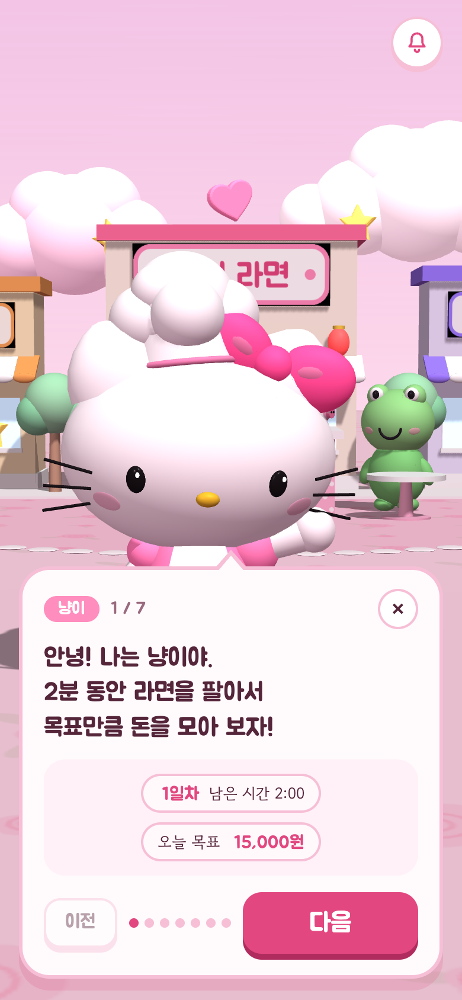
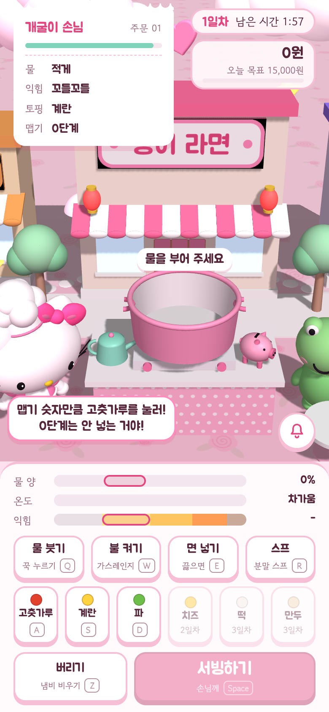
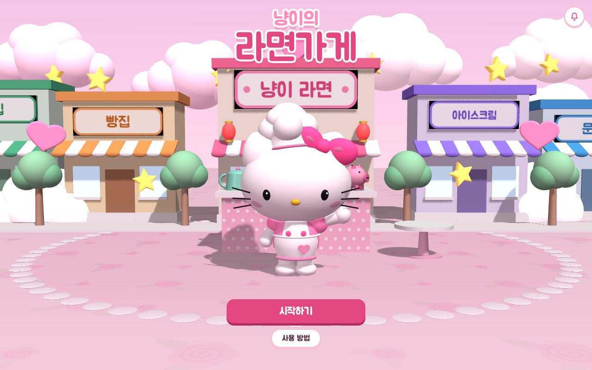
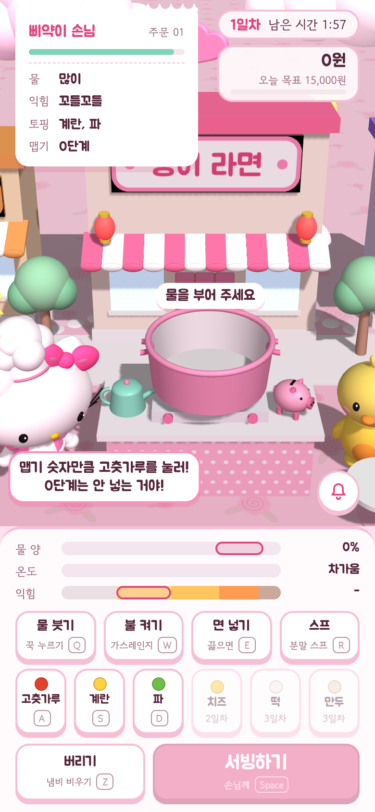

  <iframe src="https://k-im-rose.github.io/aiffel/nyangi-ramen-shop/" title="냥이의 라면가게 게임" loading="lazy" allow="autoplay; fullscreen"></iframe>

<a href="https://k-im-rose.github.io/aiffel/nyangi-ramen-shop/" target="_blank" rel="noopener">게임 플레이하기</a> · <a href="https://github.com/k-im-rose/aiffel/tree/main/nyangi-ramen-shop" target="_blank" rel="noopener">GitHub 보기</a>

## 1. 어떤 생각에서 시작했나?

사실 나는 게임을 별로 좋아하지 않는다. 그런데 AI로 게임을 만들어 보는 수업에서 가장 먼저 떠오른 건 어린 시절 즐겨 하던 '슈의 라면가게'였다.

손님의 주문대로 라면을 끓이는 단순한 게임인데, 생각보다 어려워서 꽤 재미있게 했던 기억이 있다.

이번 작업은 처음으로 바이브 코딩을 경험하는 과제였다. 거창한 기획보다는 익숙한 게임 하나를 직접 만들어 보고 싶었다. 여기에 내가 좋아하는 고양이 캐릭터를 더해 3D 라면가게를 만들기로 했다.

## 2. 무엇을 만들었나?

손님의 주문에 맞춰 라면을 끓이고, 정해진 시간 안에 목표 매출을 달성하는 게임이다.

물을 붓고 끓이는 것부터 면과 스프, 토핑을 넣고 서빙하는 과정까지 직접 조작할 수 있다. 물의 양이나 면의 익힘 정도가 주문과 다르면 손님의 평가와 매출도 달라진다.

3D 고양이 캐릭터와 동물 손님, 알록달록한 상점가를 구현했고, PC와 모바일에서 모두 플레이할 수 있도록 만들었다.

<figure class="shot">
  
  <figcaption>사용 방법 첫 장. 긴 설명 대신 냥이가 말풍선으로 한 단계씩 알려 준다.</figcaption>
</figure>

<figure class="shot">
  
  <figcaption>조리 화면. 주문서를 보고 물, 불, 면, 스프, 토핑 순서로 라면을 만든다.</figcaption>
</figure>

## 3. 어떻게 만들고 개선했나?

처음에는 AI에게 참고 이미지와 함께 원하는 게임을 설명했다. Claude Code가 코드를 작성했고, 생각보다 빠르게 실제로 움직이는 게임이 만들어졌다.

그런데 막상 결과물을 보니 아쉬운 부분이 많았다.

특히 디자인이 마음에 들지 않았다. 캐릭터는 참고 이미지와 달랐고, 화면 구성도 내가 생각했던 분위기와 거리가 있었다.

디자인 작업을 해왔던 만큼 기능이 작동하는 것만으로 만족하기 어려웠다. 게임을 직접 플레이하면서 화면의 작은 부분까지 계속 수정하기 시작했다.

### 캐릭터와 공간 디자인

처음 만들어진 캐릭터는 몸의 형태나 얼굴 비율이 어색했다. 참고 이미지를 추가하고, 눈과 코의 위치, 귀의 크기, 수염의 길이 등을 하나씩 조정했다.

캐릭터만 덩그러니 놓인 첫 화면도 바꿨다. 뒤에 라면가게와 빵집, 꽃집 등 작은 상점가를 만들고 바닥에는 장미 무늬를 넣었다. 캐릭터에게 앞치마와 요리 모자도 씌웠다.

<figure class="shot">
  
  <figcaption>첫 화면. 캐릭터 뒤로 상점가를 넣고, 바닥에는 장미 무늬를 깔았다.</figcaption>
</figure>

### 화면 구성과 사용자 경험

게임을 해보니 디자인뿐 아니라 사용하기 불편한 부분도 보였다.

* 첫 화면에 설명이 너무 많아 캐릭터 중심으로 다시 구성했다.
* 냄비가 작아 라면이 잘 보이지 않아 크기와 카메라 구도를 조정했다.
* 모바일에서 말풍선과 버튼이 겹쳐 위치와 여백을 여러 번 수정했다.
* 키보드 단축키를 한곳에 모아 조작하기 편하게 만들었다.
* 게임 시간이 길게 느껴져 3분에서 2분으로 줄였다.

특히 모바일에서는 PC에서 괜찮아 보이던 화면도 다르게 나타났다. 실제 휴대폰으로 확인하면서 카메라 각도와 화면 배치를 반복해서 조정했다.

<figure class="shot">
  
  <figcaption>휴대폰 세로 화면. 말풍선과 버튼이 겹치지 않도록 위치와 여백을 맞췄다.</figcaption>
</figure>

처음에는 단순히 게임을 만들어 보고 싶었는데, 작업을 계속할수록 기능보다 화면의 완성도를 높이는 데 더 많은 관심이 생겼다.

## 4. AI와 어떻게 협업했나?

이번 작업에서 코드를 직접 작성한 것은 AI였다. 나는 원하는 결과를 설명하고, 만들어진 게임을 확인한 뒤 수정할 부분을 찾아 다시 요청했다.

처음에는 "이 캐릭터처럼 만들어 줘"처럼 비교적 막연하게 요청했다. 하지만 AI가 만든 결과는 내가 상상한 모습과 달랐다.

수정을 반복하면서 요청도 구체적으로 바뀌었다.

단순히 캐릭터가 이상하다고 말하기보다 얼굴의 어느 부분이 다른지 설명했고, 화면이 답답하다고 느끼면 카메라 위치나 여백을 어떻게 바꾸면 좋을지 전달했다.

AI가 제안한 설정을 그대로 받아들이지 않고 직접 플레이하면서 판단한 것도 중요했다. 물이 끓는 시간이 너무 길거나 손님이 기다리는 시간이 짧으면 게임의 규칙을 다시 조정했다.

원하는 결과를 얻으려면 AI에게 정확하게 설명하고, 결과를 직접 확인하는 과정이 필요했다.

## 5. 만들고 나서 무엇이 달라졌나?

**구축 결과**

* 첫 바이브 코딩으로 실제 플레이할 수 있는 3D 웹 게임을 완성했다.
* 게임 시작부터 조리, 평가, 매출 정산까지 전체 흐름을 구현했다.
* 캐릭터 디자인과 공간, 화면 구성, 조작 방식을 반복해서 개선했다.
* PC와 모바일에서 실행할 수 있도록 조정하고 GitHub Pages에 배포했다.

## 작업을 마치며

처음에는 말로 설명하는 것만으로 게임이 만들어진다는 사실이 신기했다. 평소라면 개발을 배워야 시도할 수 있었을 일을 AI와 함께 직접 만들어 볼 수 있었다.

웹사이트도 만들고 게임도 만들어 보면서, 이것들이 어떤 구조로 돌아가는지 조금은 알 것 같다.

하지만 만드는 것이 쉬워졌다고 해서 원하는 결과까지 쉽게 나오는 것은 아니었다.

특히 캐릭터 디자인은 여러 번 수정해도 생각한 모습에 완전히 가까워지지 않았다. 마음에 들지 않는 부분을 찾아 설명하고, 다시 만들어진 결과를 확인하는 과정을 반복해야 했다.

이번 작업에서 느낀 것은 AI가 구현을 도와줄 수는 있지만, 결과물의 완성도를 판단하는 것은 결국 사람의 몫이라는 점이다.

지금은 뭐든 만드는 것이 쉬워진 시대다. 그러면 남는 질문은 하나다. 어떻게 지시하고, 어떻게 발전시키느냐.

결국 기획 싸움이 아닐까.

그래서 AI 시대에 철학과 미감이 더 중요하다는 말이 이제 조금 이해된다. 무엇이 좋은지 알아보고, 왜 그렇게 해야 하는지 설명할 수 있어야 AI에게도 정확하게 전할 수 있다. 결국 내 생각을 글로 쓰고 표현하는 일이 더 중요해진 것 같다.

첫 바이브 코딩이었기에 처음부터 체계적으로 기획하지는 못했다. 그 대신 직접 만들고 고치면서 AI와 협업하는 방식을 배웠다.

무엇보다 머릿속에 있던 아이디어를 실제로 움직이는 결과물로 만들어 냈다는 점이 재미있었다.
