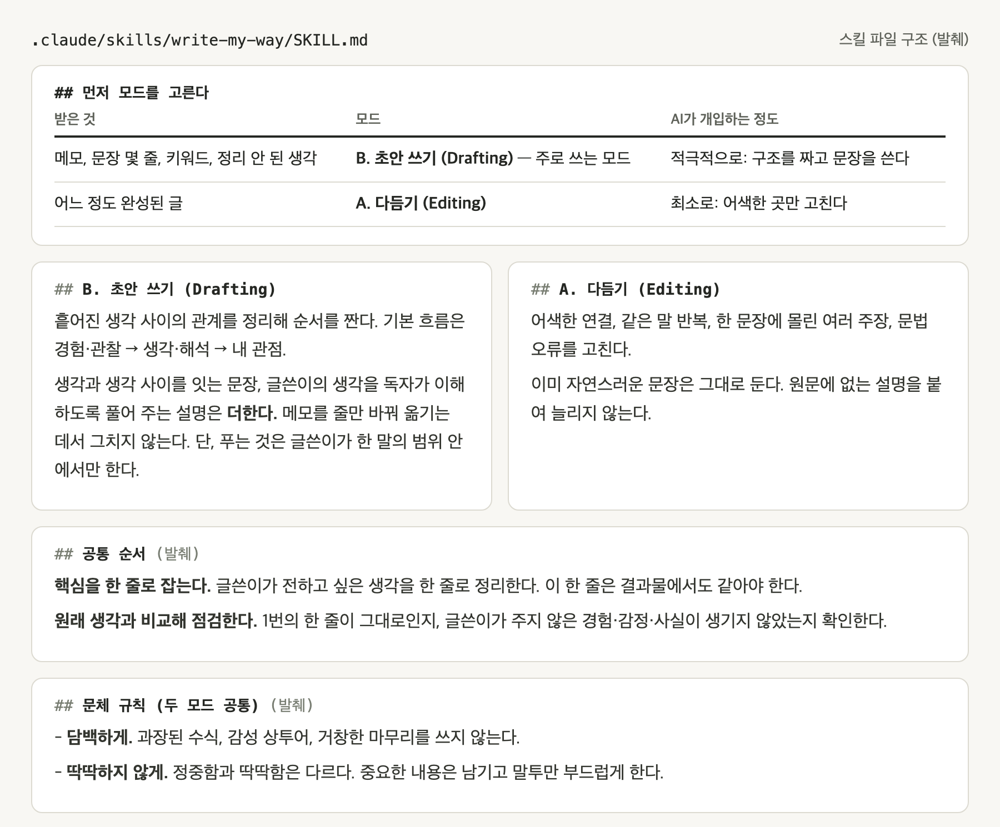
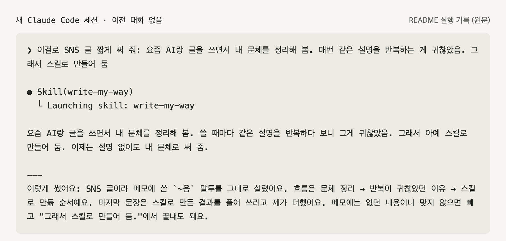
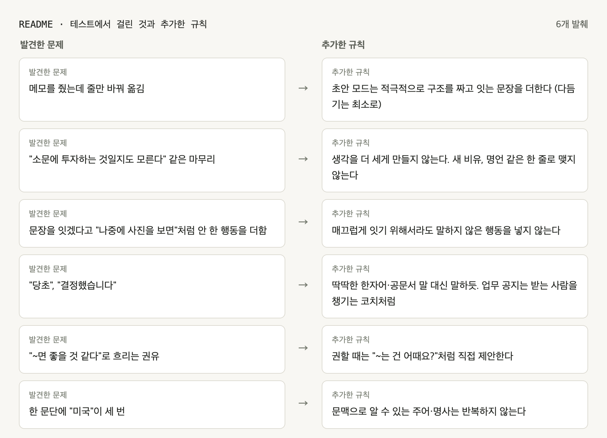

<a href="https://github.com/k-im-rose/aiffel/tree/main/my-skills" target="_blank" rel="noopener">GitHub와 README 보기</a> · <a href="https://github.com/k-im-rose/aiffel/blob/main/my-skills/.claude/skills/write-my-way/SKILL.md" target="_blank" rel="noopener">스킬 파일 보기</a>

**반복해서 설명하던 나의 글쓰기 기준을 AI 스킬로 만들다**

## 1. 어떤 문제에서 시작했나?

나는 평소 AI와 함께 글을 쓰는 일이 많다. 생각나는 대로 메모를 전달하고 글로 정리해 달라고 하거나, 이미 작성한 글을 더 자연스럽게 다듬어 달라고 요청한다.

그 과정에서 나름의 글쓰기 기준이 생겼다. 과장하지 않고 담백하게 쓰는 것, 쉬운 말을 사용하는 것, 무엇보다 내가 하지 않은 생각을 마음대로 더하지 않는 것이다.

그런데 새로운 대화를 시작할 때마다 이 기준을 다시 설명해야 했다.

"너무 딱딱해", "좀 더 담백하게", "내가 하려던 말이 아니야."

비슷한 수정을 반복하다 보니, **매번 설명하지 않아도 내 문체를 이해하고 글을 써 주는 AI를 만들 수 없을까?** 하는 생각이 들었다.

## 2. 사용하는 사람은 누구인가?

우선 나 자신을 위해 만들었다.

나는 처음부터 완성된 글을 쓰기보다, 머릿속에 떠오르는 생각을 몇 문장으로 전달하는 경우가 많다.

그래서 필요한 기능도 두 가지로 나눴다.

- **초안 쓰기:** 정리되지 않은 메모를 전달하면 내 생각을 유지하면서 하나의 글로 완성한다.
- **다듬기:** 이미 작성한 글은 뜻을 바꾸지 않고 어색한 표현과 반복만 고친다.

두 작업에서 AI가 개입해야 하는 정도는 다르다.

초안을 작성할 때는 문장의 순서와 연결을 적극적으로 정리해야 하지만, 완성된 글을 다듬을 때는 원문을 최대한 유지해야 한다.

이 차이를 구분하는 것부터 스킬 설계를 시작했다.

## 3. 어떻게 해결했나?

### 반복하던 요청을 하나의 규칙으로

먼저 평소 글쓰기를 함께하던 ChatGPT에 그동안의 대화를 분석해 달라고 요청했다.

자주 수정했던 표현, 좋아했던 문장, 원하지 않았던 글의 특징을 모았다. 이를 바탕으로 Claude Code에서 사용할 `SKILL.md` 파일을 작성했다.

가장 중요한 원칙은 하나였다.

**'잘 쓴 글'보다 '내 생각이 정확하게 전달되는 글'.**

AI가 문장을 자연스럽게 만들더라도 내가 말하지 않은 경험이나 생각을 추가해서는 안 된다.

<figure class="shot">
  
  <figcaption>SKILL.md 발췌. 모드를 먼저 고르고, 초안 쓰기와 다듬기 규칙을 따르며, 두 모드에 공통으로 적용하는 문체 규칙이 함께 있다.</figcaption>
</figure>

### 글의 종류에 따라 다르게 쓰기

독후감, SNS, 업무 공지, 개인 메시지는 각각 목적과 독자가 다르다.

그래서 모든 글을 같은 말투로 바꾸지 않도록 기준을 나눴다.

| 글의 종류 | 적용한 기준 |
|---|---|
| 블로그·독후감 | 내 경험과 해석 중심으로 담백하게 |
| SNS | 짧고 자연스럽게, 원래의 말버릇 유지 |
| 업무 공지 | 정중하지만 딱딱하지 않게 |
| 개인 메시지 | 말하듯 자연스럽게 |
| 완성된 글 수정 | 원문의 의미와 중요한 정보 유지 |

문장의 길이와 연결 방식, 반복되는 단어, 과장된 표현을 처리하는 규칙도 구체적으로 정리했다.

### 필요할 때 자동으로 실행하기

스킬을 만든 뒤에는 매번 파일을 직접 지정하지 않아도 되도록 했다.

"이걸로 글 써 줘", "이 글 다듬어 줘"라고 요청하면 Claude Code가 작업의 성격을 파악해 스킬을 불러오는 방식이다.

메모만 전달했을 때는 초안 작성 규칙을, 완성된 글을 전달했을 때는 다듬기 규칙을 적용한다.

반대로 주제만 주고 글의 내용까지 새로 만들어 달라는 요청에는 스킬이 실행되지 않도록 범위를 제한했다.

<figure class="shot">
  
  <figcaption>README에 기록된 실행 내용을 원문 그대로 옮겼다. 스킬 이름을 말하지 않고 메모만 보냈을 때 Skill(write-my-way)가 자동으로 실행됐다.</figcaption>
</figure>

## 4. 어떻게 검증하고 고쳤나?

스킬을 작성하는 것만으로 끝내지 않았다.

이전 대화의 도움 없이도 제대로 작동하는지 확인하기 위해 **매번 새로운 Claude Code 세션에서 테스트**했다.

SNS 글, 업무 안내문, 독후감, 자기소개 등 실제로 자주 작성하는 글을 활용했다.

### 테스트하면서 발견한 문제

| 발견한 문제 | 개선한 규칙 |
|---|---|
| 메모를 줄만 바꿔 그대로 옮김 | 초안 작성 시 문장 구조와 연결을 적극적으로 보완 |
| 말하지 않은 경험을 추가함 | 사용자에게 없는 경험·행동·감정은 만들지 않기 |
| 글 끝에 명언 같은 문장이 붙음 | 새로운 비유나 과장된 결론을 추가하지 않기 |
| 업무 공지가 지나치게 딱딱해짐 | 공문서 표현보다 자연스럽고 정중한 말투 사용 |
| 같은 단어나 주장이 반복됨 | 문맥상 불필요한 반복은 제거 |
| 완성된 글까지 과하게 수정함 | 다듬기에서는 필요한 부분만 최소한으로 수정 |

특히 AI가 글을 매끄럽게 만들면서 **내가 하지 않은 생각을 자연스럽게 추가하는 문제**가 반복됐다.

그래서 문장을 보완하는 것과 새로운 내용을 만들어 내는 것의 경계를 명확히 했다.

<figure class="shot">
  
  <figcaption>README에 기록된 테스트 사례 중 6개를 골라, 발견한 문제와 추가한 규칙을 짝지어 나란히 놓았다. 수정 후 결과 기록은 없어서 문제와 규칙만 보여 준다.</figcaption>
</figure>

### 실제 작동 확인

새로운 세션에서 스킬 이름을 말하지 않고, 메모와 함께 "이걸로 SNS 글 짧게 써 줘"라고 요청했다.

Claude Code는 Write My Way 스킬을 자동으로 불러왔고, 메모의 말투와 핵심 내용을 유지하면서 글을 작성했다.

업무 공지와 독후감 등 다른 글에서도 같은 방식으로 테스트했다. 반대로 스킬을 사용하지 않아야 하는 요청에서는 실행되지 않는 것도 확인했다.

테스트할 때마다 발견한 문제를 규칙에 반영하면서 결과를 개선해 나갔다.

## 5. 앞으로 어떻게 발전시킬 계획인가?

현재는 개인 글쓰기 도구로 사용하기 위한 스킬을 완성한 상태다.

앞으로도 실제로 글을 쓰면서 마음에 들지 않는 표현이나 반복되는 수정 요청이 생기면 규칙을 보완할 생각이다.

특히 글의 종류에 따라 AI가 개입하는 정도를 더 세밀하게 조정하고 싶다.

장기적으로는 글쓰기뿐 아니라 **내가 일하는 방식과 판단 기준도 스킬로 정리**해 보고 싶다.

매번 같은 설명을 반복하는 대신, 내가 중요하게 생각하는 기준을 AI가 일관되게 적용하도록 만드는 것이다.
