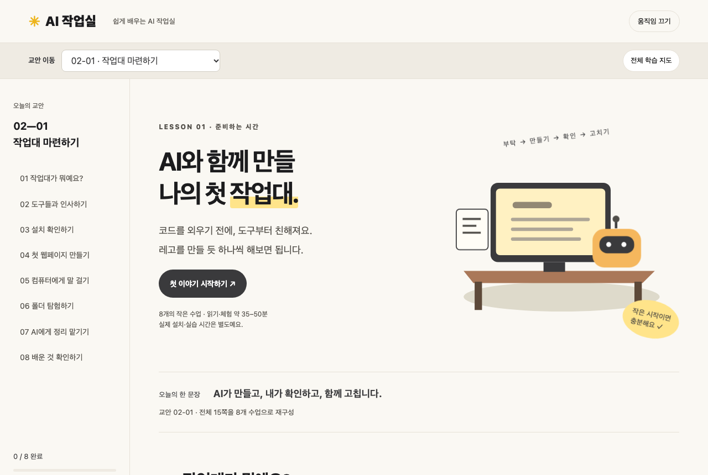
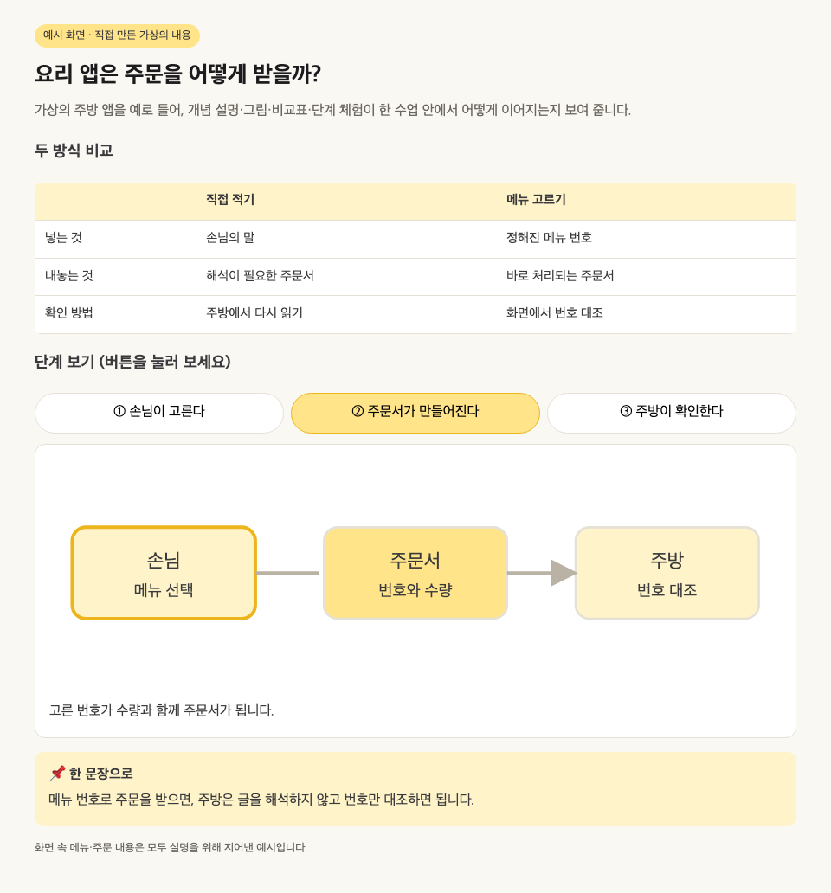
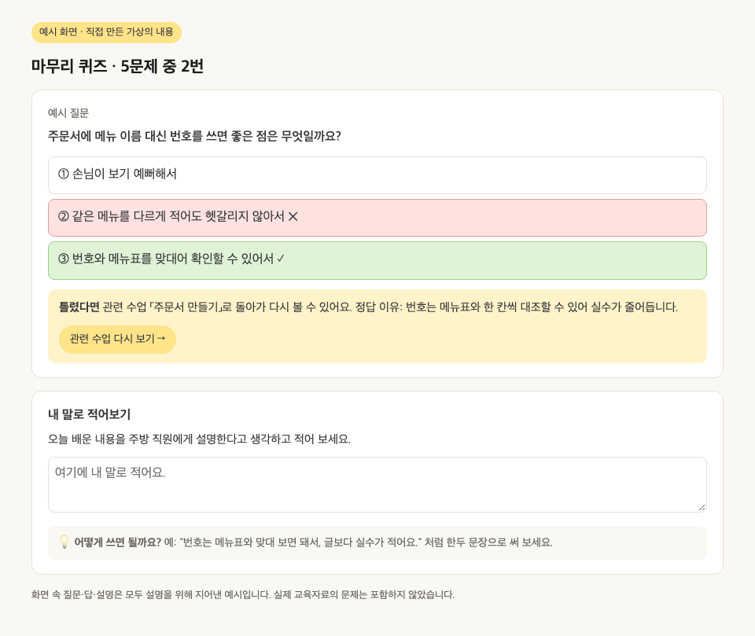
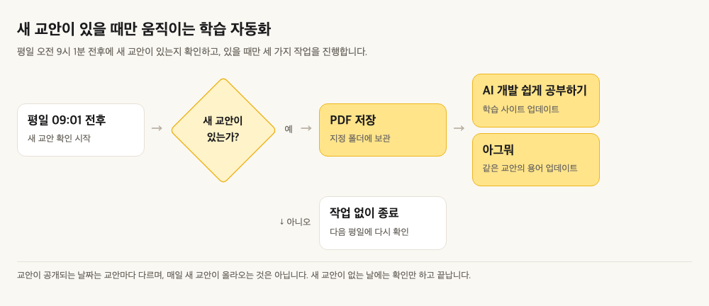

**새로 공개되는 AI 교안을 쉽게 바꾸고, 학습 준비까지 자동화하다**

## 1. 어떤 문제에서 시작했나?

모두의연구소에서 AI 개발을 배우기 시작하면서 정해진 일정에 따라 새로운 교안을 받았다.

개발을 처음 배우다 보니 모르는 용어가 많았다. 설명을 읽어도 이해되지 않는 경우가 많아서 그때마다 AI에게 쉬운 말로 다시 설명해 달라고 요청했다.

수업에서는 교안 내용을 다른 동기들에게 설명해야 하는 시간도 있었다. 내가 이해하지 못한 내용을 다른 사람에게 설명하려니 더 철저하게 공부할 필요가 있었다.

문제는 이 과정이 새 교안이 열릴 때마다 반복된다는 것이었다.

**어려운 교안을 매번 다시 설명해 달라고 하기보다, 처음부터 내가 이해할 수 있는 수업으로 만들어 두면 어떨까?**

## 2. 사용하는 사람은 누구인가?

AI 개발을 처음 배우는 나 자신을 위해 만들었다.

단어의 뜻을 쉽게 바꾸는 것만으로는 부족했다. 새로운 개념이 왜 필요한지, 실제로 어디에 사용하는지까지 이해해야 했다.

또한 교안을 읽는 것으로 끝내지 않고, 직접 내용을 확인하고 복습할 수 있는 공간이 필요했다.

그래서 원래 교안의 내용을 내 수준에 맞게 풀어 설명하고, 그림과 예시, 간단한 체험을 통해 이해할 수 있는 학습 사이트를 구상했다.

## 3. 어떻게 해결했나?

### 어려운 교안을 하나의 수업으로

Claude Code와 Claude Artifact를 활용해 개인 학습 사이트 **‘AI 개발 쉽게 공부하기’**를 만들었다.

<figure class="shot">
  
  <figcaption>학습 사이트 전체 구조. 상단 교안 이동 메뉴로 전체 교안을 고르고, 왼쪽 목차에서 수업 순서를 확인한다. 교안 본문은 일부러 싣지 않았다.</figcaption>
</figure>

원래 교안의 핵심 개념을 유지하면서 내용을 쉬운 말로 다시 구성했다.

처음에는 쉬운 비유를 많이 사용했지만, 비유만으로 설명하면 실제 개념을 정확히 이해하기 어렵다는 문제가 있었다.

그래서 설명 방식도 바꿨다.

먼저 개념이 왜 필요한지 설명하고, 실제 예시를 보여준 다음, 헷갈리기 쉬운 부분을 짚어 주도록 했다. 각 수업의 마지막에는 핵심을 한 문장으로 정리했다.

### 읽는 것에서 직접 확인하는 학습으로

글만 읽는 것으로는 이해했는지 확인하기 어려웠다.

그래서 설명을 돕는 그림과 비교표, 직접 값을 바꿔 볼 수 있는 체험 기능을 추가했다.

<figure class="shot">
  
  <figcaption>개념 학습 기능의 예시 화면. 비교표와 단계 버튼으로 그림을 한 단계씩 보는 방식이다. 화면 속 내용은 설명을 위해 직접 만든 예시다.</figcaption>
</figure>

학습 중에는 내 말로 내용을 정리할 수 있고, 교안 마지막에는 객관식 퀴즈로 이해도를 확인할 수 있게 했다.

틀린 문제는 관련 수업으로 돌아가 다시 읽을 수 있도록 연결했다. 무엇을 적어야 할지 막막한 질문에는 예시 답안도 추가했다.

<figure class="shot">
  
  <figcaption>복습 기능의 예시 화면. 틀린 문제에서 관련 수업으로 돌아가고, 내 말로 적는 칸에는 예시 답안을 함께 보여 준다. 퀴즈 문제는 직접 만든 예시다.</figcaption>
</figure>

### 반복되는 세 가지 작업을 자동화하기

새 교안은 정해진 날짜의 오전 9시에 공개된다.

처음에는 교안을 내려받고, 내용을 쉽게 바꾸고, 용어를 정리하는 일을 각각 요청했다.

이 반복 작업을 줄이기 위해 평일 오전 9시 1분 전후에 새 교안이 있는지 확인하는 자동화 흐름을 만들었다. 새 교안이 있을 때만 아래 세 가지 작업을 진행한다.

**첫 번째, PDF 저장.** 새로 공개된 교안을 PDF로 내려받아 내 컴퓨터의 지정된 폴더에 저장한다. 교육과정이 끝나면 교안에 접근할 수 없기 때문에 원본을 개인 학습용으로 보관할 필요가 있었다.

**두 번째, AI 개발 쉽게 공부하기 업데이트.** 저장한 PDF를 바탕으로 쉬운 설명과 예시, 그림, 퀴즈가 포함된 새 학습 페이지를 만든다.

**세 번째, 아그뭐 업데이트.** 같은 교안에서 새로 등장한 용어를 추출하고 정리해, 별도로 만든 AI 용어 사전 ‘아그뭐’에 추가한다.

하나의 교안으로 학습 페이지와 용어 사전이 함께 업데이트되는 구조다.

<figure class="shot">
  
  <figcaption>자동화 흐름. 새 교안이 있을 때만 PDF를 보관하고, 같은 교안으로 학습 페이지와 용어 사전을 함께 갱신한다. 새 교안이 없으면 확인만 하고 끝난다.</figcaption>
</figure>

[아그뭐 프로젝트 자세히 보기](https://k-im-rose.github.io/2026/11/15/agmwo.html)

## 4. 어떻게 검증하고 고쳤나?

실제로 공부하면서 이해하기 어려운 설명과 사용하기 불편한 기능을 계속 수정했다.

**쉬운 설명만으로는 부족했다.** 비유만 읽으면 이해한 것 같아도 원래 개념을 설명하기 어려웠다. 그래서 개념의 배경과 실제 사용 장면을 먼저 설명하고, 비유는 보조적으로 사용하도록 기준을 바꿨다.

**새 교안이 추가될 때마다 같은 작업이 반복됐다.** 교안마다 화면을 새로 구성하는 대신, 공통 양식을 만들고 새 교안을 등록하면 메뉴와 이전·다음 이동이 자동으로 연결되도록 했다.

**복습 기능도 보완했다.** 교안 마지막에 마무리 퀴즈를 모으고, 틀린 문제에서 관련 수업으로 돌아갈 수 있도록 했다. 직접 답을 적는 항목에는 예시 답안도 추가했다.

이러한 기준을 Claude Code의 `add-lesson` 스킬로 정리해, 새로운 교안도 같은 구조로 제작할 수 있게 했다.

## 5. 앞으로 어떻게 발전시킬 계획인가?

현재는 내가 AI 개발을 이해하고 복습하는 데 집중한 개인 학습 도구다.

앞으로도 공부하면서 어렵게 느껴지는 설명이나 부족한 기능을 계속 개선할 생각이다.

특히 새로 추가되는 교안이 이전 내용과 어떻게 연결되는지 한눈에 볼 수 있으면 좋겠다. 배운 내용을 단순히 쌓는 데서 그치지 않고, 어떤 개념을 이해했고 무엇을 다시 공부해야 하는지 확인할 수 있는 방향으로 발전시키고 싶다.

교육자료의 권리는 제공 기관에 있으므로 학습 사이트 전체를 공개하지는 않는다. 포트폴리오에는 직접 설계한 기능과 자동화 과정, 일부 화면만 소개한다.
