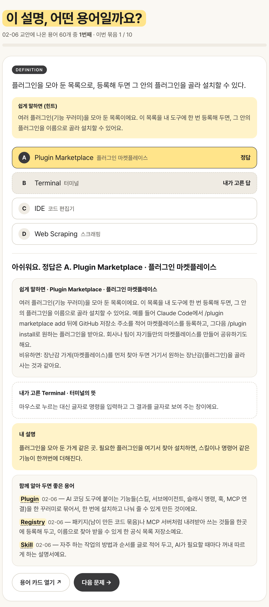

  <iframe src="https://aiffel-study-terms.onrender.com/" title="아, 그게 뭐더라? 용어 사전" loading="lazy"></iframe>

<a href="https://aiffel-study-terms.onrender.com/" target="_blank" rel="noopener">새 창에서 크게 보기</a> · <a href="https://aiffel-study-terms.onrender.com/quiz.html" target="_blank" rel="noopener">퀴즈 풀기</a> · <a href="https://github.com/k-im-rose/aiffel/tree/main/study-terms-app" target="_blank" rel="noopener">코드와 README 보기</a>

## 1. 어떤 문제에서 시작했나?

AI 개발을 배우는 과정에서 거의 매일 새 교안을 받았다. 한 편마다 처음 보는 용어가 수십 개씩 나왔다. 처음 받은 교육자료 12개에서만 뽑아도 약 600개였다.

수업을 들을 때는 "아, 그렇구나" 하고 넘어갔다. 문제는 그다음에 나타났다.

- 실습에서 같은 용어를 다시 만나도 뜻이 떠오르지 않았다.
- 누가 물어보면 **말로 설명하지 못했다.** 읽을 때는 이해한 것 같았는데, 입으로는 한 문장도 나오지 않았다.
- 다시 찾으려면 어느 교안에서 봤는지 몰라 여러 교안을 뒤져야 했다.
- 비슷한 용어끼리 차이가 헷갈렸다.

검색하거나 AI에게 물으면 답은 바로 나온다. 하지만 어제 물어본 것을 오늘 또 묻게 되고, 내가 어떻게 이해했는지는 어디에도 남지 않았다. 읽어서 익숙한 것과 내가 설명할 수 있는 것은 다르다. 이 차이를 메우는 학습 도구가 필요하다고 보고 직접 기획했다.

> "이해한 것이 내 것으로 남지 않고, 매번 다시 찾아본다."

## 2. 사용하는 사람은 누구인가?

**AI 개발을 막 배우는 입문자**다. 첫 사용자는 나 자신이었다. 기능을 만들고 끝낸 것이 아니라 매일 직접 쓰면서, 막히는 곳과 고칠 곳을 찾았다.

다음과 같은 상황에서 쓴다.

1. 강의를 듣고 새 용어를 정리할 때
2. 실습하다 헷갈리는 용어를 사전처럼 찾을 때
3. 다음 수업 전에 복습할 때

## 3. 어떻게 문제를 해결했나?

앱의 규칙은 하나로 정했다. **"내 말로 설명할 수 있어야 안다."**

### A. 기능을 고른 기준

처음 후보는 세 가지였다. 투자 뉴스 알림, 냉장고 재료 앱, 공부 용어 앱이다. 투자 알림이 가장 하고 싶은 일이었지만, 외부 데이터와 AI 분석, 알림이 모두 필요해서 첫 작업으로는 너무 컸다. 그래서 다음 세 가지 기준을 세웠다.

- 흐름 하나가 처음부터 끝까지 돌아가는가
- 화면에서 직접 눌러 확인할 수 있는가
- 외부 데이터 없이 만들 수 있는가

공부 용어 앱은 이 기준을 통과했다. 매일 수업이 열릴 때마다 쓰면서 키울 수 있었기 때문이다. 기능을 많이 만드는 것보다 실제 공부에 도움이 되는지를 먼저 봤다. 처음부터 모든 기능을 만들지 않고, 공부하다 반복해서 막히는 문제부터 풀었다.

문제마다 이렇게 풀었다.

| 문제 | 해결 |
|---|---|
| 뜻이 떠오르지 않는다 | 열자마자 검색창이 보이는 **사전**. 한글, 영어, 첫 글자만 쳐도 찾아진다 |
| 설명을 못 한다 | **내가 쓴 설명을 저장**하고, 설명을 써야 '마치기'가 눌린다 |
| 어디서 봤는지 모른다 | 용어마다 **처음 나온 교안 번호**를 붙였다 |
| 비슷한 용어가 헷갈린다 | **함께 알면 좋은 용어**로 바로 넘어가 비교한다 |
| 아는 것 같은 착각 | 알아보기, 다시보기, 마치기 **세 단계**로 내 상태를 나눈다 |
| 읽을 땐 아는데 다음 날 기억이 안 난다 | 기억에서 꺼내 보는 **퀴즈**를 추가했다 |

### 화면은 이렇게 생겼다

**찾기.** 열자마자 검색창이 보인다. `ㅎㄴㅅ`처럼 첫 글자만 쳐도 하네스가 나오고, 찾은 글자는 노란 형광펜으로 칠해진다.

<figure class="shot">
  
  <figcaption>검색창에 <code>ㅎㄴㅅ</code>만 쳐도 <strong>하네스</strong>가 바로 나온다.</figcaption>
</figure>

**읽기.** 카드는 위에서 아래로 읽는다. 교안의 뜻(DEFINITION)을 먼저 보고, 쉽게 말하면, 예를 들면, 언제 쓰냐면 순서로 이어진다. 점선 밑줄이 있는 말을 누르면 그 용어로 넘어간다.

<figure class="shot">
  
  <figcaption>MCP 카드. 교안의 뜻부터 실제로 쓰는 장면까지 한 카드에 있다.</figcaption>
</figure>

**진도 보기.** 목록 맨 위에 전체 진도가 보이고, 교안별로 묶어서 볼 수 있다.

<figure class="shot">
  
  <figcaption>왼쪽 목록. 전체 진도(<code>마치기 1 / 629</code>), 상태별 개수, 교안별 진도가 보인다.</figcaption>
</figure>

### B. 설명을 써야 끝나는 학습 규칙

이 앱에서 가장 강조하고 싶은 부분이다. 설명을 읽고 넘어가기만 하면 다른 용어 사전과 다를 게 없다고 봤다. 그래서 카드 아래 **MY NOTE**에 내 말로 적어야만 '마치기'가 눌리게 했다. 설명을 쓰려면 한 번 더 생각해야 하고, 그 과정에서 내가 모르는 부분이 드러난다.

이 규칙은 학습 행동을 바꾸기 위한 장치다. 메모를 남기는 기능으로 만든 것이 아니다. 화면에서만 막으면 우회할 수 있어서, 서버와 저장소에서도 같은 조건을 확인하도록 했다.

<figure class="shot">
  
  <figcaption>카드 아래쪽. 내 말로 적은 뒤 마치기를 누른다. (화면 속 설명은 예시다.)</figcaption>
</figure>

### C. 읽은 것을 기억에서 꺼내 보는 퀴즈

설명을 읽는 것만으로는 다음 날 기억이 나지 않았다. 그래서 뜻을 보고 용어를 4개 보기에서 고르는 퀴즈를 만들었다. 교안을 고르면 그 교안에 나온 용어가 한 번씩 문제로 나온다.

틀리면 해설에 정답의 쉬운 풀이와 내가 써 둔 설명이 함께 나온다. 왜 헷갈렸는지, 내가 어떻게 이해했었는지를 한 화면에서 확인할 수 있다.

<figure class="shot">
  
  <figcaption>문제 화면. 막히면 힌트 보기로 쉬운 풀이의 앞 두 문장을 연다.</figcaption>
</figure>

<figure class="shot">
  
  <figcaption>일부러 틀려 본 해설 화면.</figcaption>
</figure>

### D. 반복 작업을 하나의 절차로 묶기

새 교안이 열리면 PDF를 저장하고, 용어를 추가하고, 배포하는 일을 매번 같은 순서로 했다. 이 일을 하나의 절차로 정리해서, "03-05 용어 추가해줘"처럼 요청 한마디로 돌아가게 했다. AI를 새로 붙인 것이 아니라, 반복되는 작업의 순서를 줄인 것이다. 퀴즈 문제도 용어 데이터에서 규칙대로 만들어지므로 교안을 넣으면 따로 손볼 일이 없다.

## 4. 검증은 어떻게 했나?

코드는 AI가 작성했다. 나는 직접 써 보며 불편한 곳을 찾고, 어떻게 고칠지 요청한 뒤, 고쳐진 화면을 다시 확인했다.

### 사례 1: 용어 설명 방식을 바꿨다

처음에는 어려운 용어를 비유로 풀었다. 그런데 직접 공부하면서 문제가 보였다. 비유만 있으면 무엇을 빗댄 것인지 모르겠고, 결국 AI에게 다시 물어보게 됐다. 비유로는 개념을 정확히 이해하기 어려웠다.

그래서 기준을 바꿨다. 쉬운 말은 그대로 유지하되, 뜻을 쉬운 말로 정확하게 풀어 쓰기로 했다. 비유는 도움이 될 때만 끝에 한 줄로 붙인다. 이 기준으로 **629개 용어의 설명을 모두 다시 썼다.** 처음 만든 방식을 고집하지 않고, 쓰면서 드러난 문제에 맞춰 기준을 고친 일이다.

### 사례 2: 써 보며 고친 것들

- 한영 키를 바꾸지 않고 쳐도 찾아 달라고 했다. → 잘못 친 글자도 찾아지게 바꿨다.
- 검색 결과가 없을 때 아무것도 보여 주지 않았다. → 오타가 나면 비슷한 이름의 용어를 보여 주도록 바꿨다.
- 설명 속에 모르는 용어가 자주 나왔다. → 그 용어에 링크를 걸어 바로 넘어가게 했다.
- 휴대폰에서 메모장 칸이 잘리는 문제를 찾아 고쳤다.

### 규칙이 지켜지는지 확인

설명이 비어 있으면 '마치기'가 눌리지 않는다. 공백만 넣어도 눌리지 않는다. 이 규칙이 화면, 서버, 저장소에서 모두 지켜지는지 시험 코드(`npm test`)로 확인했다. 새 교안을 넣은 뒤에는 실제 사이트에서 새 용어가 보이고 그날 교안의 퀴즈가 열리는지 직접 본다.

## 5. 만들고 나서 무엇이 달라졌나?

### 구축 결과

- 용어 **629개**를 정리하고, 설명을 쉬운 풀이로 다시 썼다.
- 설명을 써야 '마치기'가 되는 학습 흐름을 만들었다.
- 교안별 용어 맞히기 퀴즈를 추가했다.
- 교안 등록 작업을 요청 한마디로 돌아가는 절차로 묶었다.

### 실제 사용과 개선

- 매일 쓰면서 찾은 문제를 기능 개선에 반영했다. 비유 설명 방식, 오타 검색, 설명 속 용어 링크가 그렇게 바뀌었다.
- 처음 기획에 없던 기능 중 상당수는 직접 쓰다가 막힌 곳에서 나왔다.

### 아직 못 한 것과 다음 과제

- 용어 뜻을 교안 원문과 한 줄씩 대조하지는 못했다. AI가 쓴 설명은 사람이 확인해야 하므로 이것을 가장 먼저 할 일로 남겨 둔다.
- 다음 단계로 AI가 내 설명을 보고 빠진 부분을 짚어 주는 기능과, 매일 용어 하나를 골라 주는 '오늘의 용어'를 계획하고 있다.
