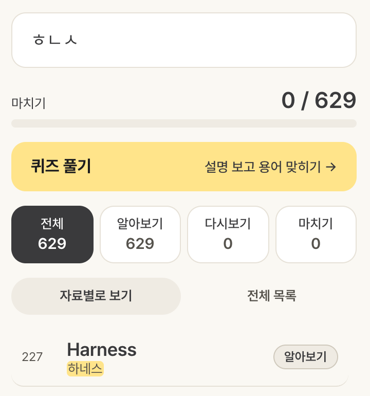
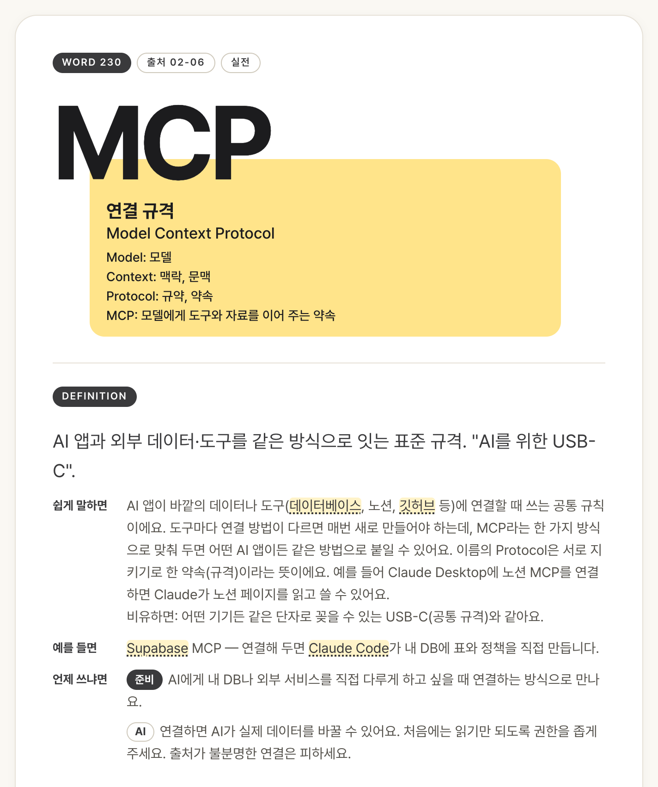
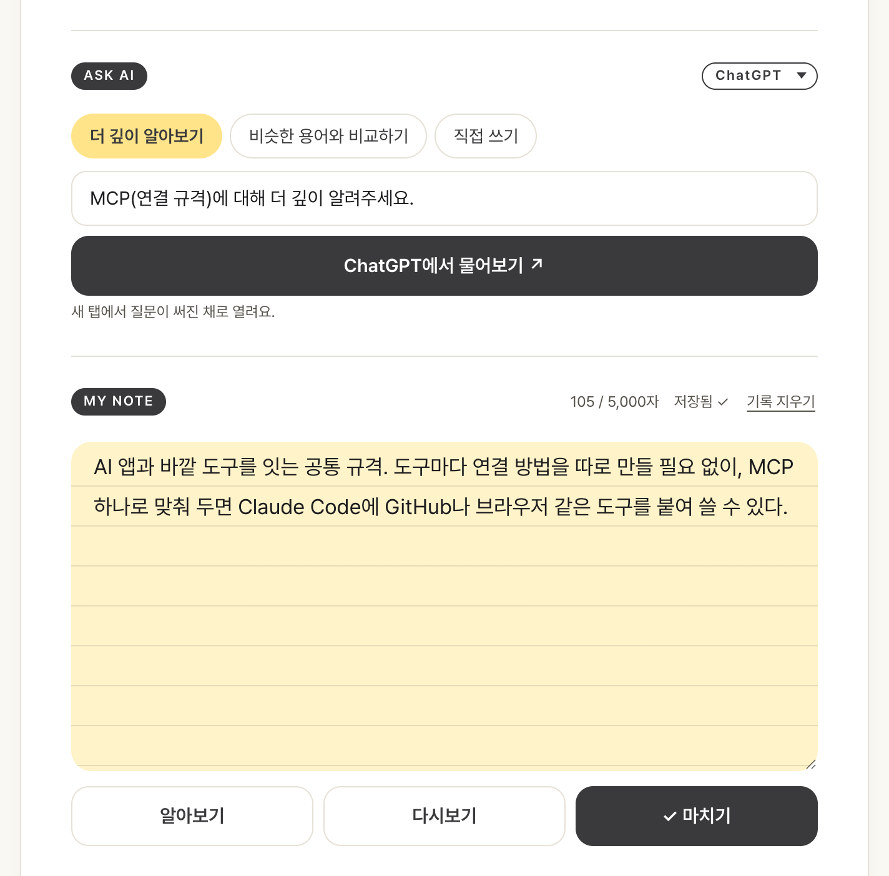
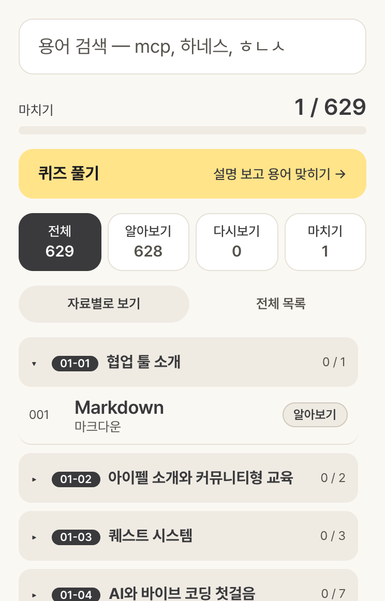
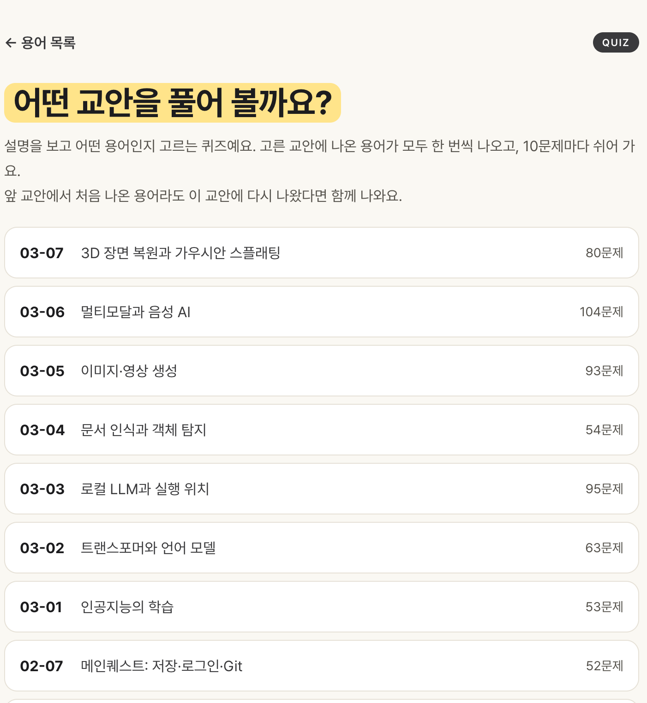
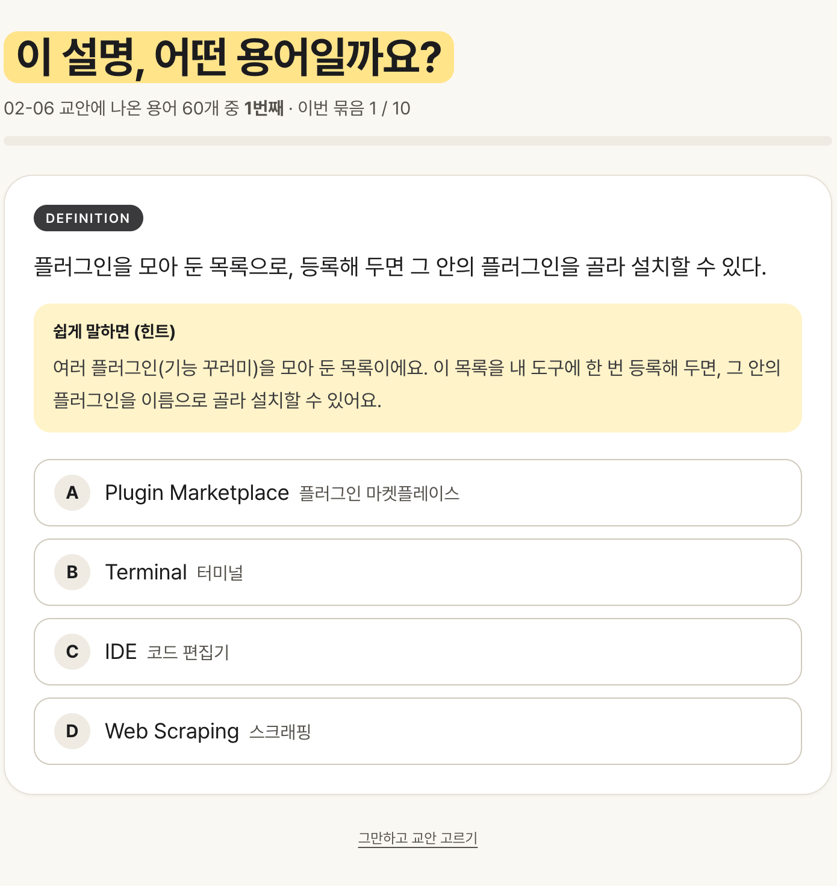

  <iframe src="https://aiffel-study-terms.onrender.com/" title="아, 그게 뭐더라? 용어 사전" loading="lazy"></iframe>

<a href="https://aiffel-study-terms.onrender.com/" target="_blank" rel="noopener">새 창에서 크게 보기</a> · <a href="https://aiffel-study-terms.onrender.com/quiz.html" target="_blank" rel="noopener">퀴즈 풀기</a> · <a href="https://github.com/k-im-rose/aiffel/tree/main/study-terms-app" target="_blank" rel="noopener">코드와 README 보기</a>

## 1. 어떤 문제에서 시작했나?

개발을 처음 배우는 과정이었다. 거의 매일 새 교안이 열렸고, 한 편마다 처음 보는 용어가 수십 개씩 나왔다. 처음 받은 교육자료 12개에서만 용어를 뽑아 보니 약 600개였다.

수업을 들을 때는 "아, 그렇구나" 하고 넘어갔다. 문제는 그다음이었다.

- 실습에서 같은 용어를 만나면 **뜻이 떠오르지 않았다.**
- 누가 물어보면 **말로 설명하지 못했다.** 읽을 때는 이해한 것 같았는데 입으로는 한 문장도 안 나왔다.
- 다시 찾으려 하면 **어느 교안에서 봤는지 몰라** 여러 교안을 뒤져야 했다.
- 비슷한 용어끼리 **차이가 헷갈렸다.**

검색하거나 AI에게 다시 물어보면 답은 바로 나온다. 하지만 어제 물어본 것을 오늘 또 묻게 되고, 내가 어떻게 이해했는지는 어디에도 남지 않는다. 읽어서 익숙한 것과 내가 설명할 수 있는 것은 다른데, 그 차이가 문제였다.

> "이해한 것이 내 것으로 남지 않고, 매번 다시 찾아본다."

## 2. 사용하는 사람은 누구인가?

**AI 개발을 막 배우는 입문자**다. 첫 사용자는 나 자신이고, 지금도 매일 쓰고 있다.

다음과 같은 상황에서 사용한다.

1. 강의를 듣고 새 용어를 정리할 때
2. 실습하다 헷갈리는 용어를 사전처럼 찾을 때
3. 다음 수업 전에 복습할 때

처음에는 투자 뉴스 알림, 냉장고 재료 앱, 공부 용어 앱을 후보로 두고 고민했다. 투자 알림이 가장 하고 싶었지만 첫 작업으로는 너무 컸다. 그래서 매일 수업이 열릴 때마다 계속 쓰고 키울 수 있는 공부 용어 앱을 골랐다.

## 3. 어떻게 문제를 해결했나?

앱의 규칙은 하나로 정했다. **"내 말로 설명할 수 있어야 안다."**

뜻을 읽고 넘어가기만 하면 다른 용어 사전과 다를 게 없다. 그래서 설명을 직접 써야만 '마치기' 버튼이 눌리게 했다. 설명을 쓰려면 한 번 더 생각해야 하고, 그 과정에서 내가 모르는 부분이 드러난다. 그렇게 쓴 설명은 다음에 같은 용어를 만났을 때 가장 빨리 떠오르는 나만의 답이 된다.

문제마다 이렇게 풀었다.

| 문제 | 해결 |
|---|---|
| 뜻이 떠오르지 않는다 | 열자마자 검색창이 보이는 **사전**. 한글, 영어, 첫 글자만 쳐도 찾아진다 |
| 설명을 못 한다 | **내가 쓴 설명을 저장**하고, 설명을 써야 '마치기'가 된다 |
| 어디서 봤는지 모른다 | 용어마다 **처음 나온 교안 번호**를 붙였다 |
| 비슷한 용어가 헷갈린다 | **함께 알면 좋은 용어**로 바로 넘어가 비교한다 |
| 아는 것 같은 착각 | 알아보기, 다시보기, 마치기 **세 단계**로 내 상태를 솔직하게 나눈다 |
| 읽을 땐 아는데 다음 날 기억이 안 난다 | 기억에서 꺼내 보는 **퀴즈**를 추가했다 |

### 화면은 이렇게 생겼다

**찾기.** 열자마자 검색창이 보인다. `ㅎㄴㅅ`처럼 첫 글자만 쳐도 하네스가 나오고, 찾은 글자는 노란 형광펜으로 칠해진다.

<figure class="shot">
  
  <figcaption>검색창에 <code>ㅎㄴㅅ</code>만 쳐도 <strong>하네스</strong>가 바로 나온다.</figcaption>
</figure>

**읽기.** 용어마다 카드가 있다. 한글 이름과 영어 전체 이름이 위에 있고, 아래로 교안의 뜻, 쉽게 말하면, 예를 들면, 언제 쓰냐면 순서로 읽는다. 점선 밑줄이 있는 말은 누르면 그 용어로 넘어간다.

<figure class="shot">
  
  <figcaption>MCP 카드. 교안의 뜻부터 실제로 쓰는 장면까지 한 카드에 있다.</figcaption>
</figure>

**내 말로 쓰기.** 카드 아래쪽 MY NOTE에 내 설명을 적고, 이해한 정도에 따라 알아보기, 다시보기, 마치기 중 하나를 누른다. 설명을 적어야만 마치기가 눌린다. ASK AI 버튼을 누르면 ChatGPT나 Claude에 질문이 써진 채로 열린다.

<figure class="shot">
  
  <figcaption>카드 아래쪽. 내 말로 적은 뒤 마치기를 누른다. (화면 속 설명은 예시다.)</figcaption>
</figure>

**진도 보기.** 왼쪽 목록 맨 위에 전체 진도가 보이고, 교안별로 묶어서 볼 수 있다.

<figure class="shot">
  
  <figcaption>왼쪽 목록. 전체 진도(<code>마치기 1 / 629</code>), 상태별 개수, 교안별 진도가 보인다.</figcaption>
</figure>

**퀴즈.** 교안을 고르면 그 교안에 나온 용어가 모두 한 번씩 문제로 나온다. 뜻을 보고 어떤 용어인지 4개 중에서 고른다.

<figure class="shot">
  
  <figcaption>첫 화면. 교안별 문제 수가 보인다.</figcaption>
</figure>

<figure class="shot">
  
  <figcaption>문제 화면. 막히면 힌트 보기로 쉬운 풀이의 앞 두 문장을 연다.</figcaption>
</figure>

틀리면 해설에 정답의 쉬운 풀이, 내가 고른 오답의 뜻, 내가 써 둔 설명이 한 화면에 나온다. 왜 헷갈렸는지, 내가 어떻게 이해했었는지를 바로 확인한다.

<figure class="shot">
  
  <figcaption>일부러 틀려 본 해설 화면.</figcaption>
</figure>

써 보면서 막힌 것은 그날 바로 고쳤다. 오타가 나면 비슷한 용어를 추천해 주고, 비유만 있던 설명은 쉬운 말 풀이로 다시 썼다. 처음 기획할 때 생각한 기능보다 직접 쓰다가 막힌 곳에서 나온 기능이 더 많았다.

반복되는 일은 자동화했다. 매일 아침 교안이 열리면 PDF 저장, 용어 추가, 학습 페이지 만들기를 똑같이 했기 때문에, 이 세 가지를 하나로 묶어 평일 아침에 자동으로 돌게 했다. 아침에 결과 보고만 받고 공부에 시간을 쓴다.

## 4. 검증은 어떻게 했나?

나는 코드를 읽지 못한다. 그래서 검증도 **말로 요청하고, 직접 써 보고, 고쳐졌는지 다시 확인하는 방식**으로 했다.

**이 앱이 돌아가는 원리 (쉬운 말로)**

음식점에 빗대면 이렇다. 손님이 보는 **매장**이 화면이고, 주문을 받아 전달하는 **점원**이 서버이고, 기록을 보관하는 **창고**가 데이터 저장소다. 내가 용어 설명을 써서 저장하면 점원이 창고에 넣어 두고, 휴대폰이든 PC든 다른 기기에서 열어도 점원이 같은 기록을 꺼내 준다.

**어떻게 확인했나**

1. **직접 써 보고, 불편하면 말로 요청했다.** 이 앱은 내가 매일 쓰는 도구라서 막히는 곳이 바로 보였다.
   - 한영 키를 안 바꾸고 쳐도 찾아 달라고 요청했다. → `ㅕㅜㄷㅅ`처럼 잘못 친 글자도 `unet`으로 찾아진다.
   - 설명 속에 또 모르는 용어가 나온다고 말했다. → 그 용어에 링크가 걸려, 눌러서 바로 넘어간다.
   - 비유만 있으면 무엇을 빗댄 건지 몰라서 AI에게 다시 묻게 된다고 말했다. → 629개 설명을 쉬운 말 풀이로 다시 썼다.
   - 읽을 땐 아는데 다음 날 기억이 안 난다고 말했다. → 퀴즈 페이지를 만들었다.
2. **정한 규칙이 진짜 지켜지는지 확인했다.** 설명이 비어 있으면 '마치기'가 안 눌린다. 공백만 넣어도 안 눌린다. 화면에서만 막으면 몰래 우회할 수 있어서, 점원(서버)과 창고에서도 똑같이 막았다. 문 앞에 경비를 세우고 안쪽 문도 잠근 셈이다.
3. **AI가 시험을 돌렸다.** 저장, 조회, 삭제가 제대로 되는지, 퀴즈 문제가 규칙대로 만들어지는지를 시험 코드로 한 번에 확인했다. 퀴즈는 용어 629개 전부를 문제로 만들어 보고, 정답이 문제 안에 새지 않는지, 보기가 4개인지 검사했다.
4. **퀴즈는 AI가 즉석에서 만들지 않는다.** 정해진 규칙으로 만든다. 그래서 틀린 문제가 생길 걱정이 적고, 쓸 때마다 비용이 들지 않는다.
5. **새 용어를 넣은 뒤에는 실제 사이트에서 확인한다.** 새 용어가 보이는지, 그날 교안의 퀴즈가 열리는지 본다. 한 단계라도 안 되면 거기서 멈추고 나에게 알려 준다.

**아직 못 한 것.** 용어 뜻은 교안 PDF를 근거로 쓰게 했지만, 한 줄씩 원문과 대조하지는 못했다. AI가 쓴 내용은 사람이 확인해야 한다는 것을 알게 됐고, 앞으로 해야 할 일로 남겨 두었다.
