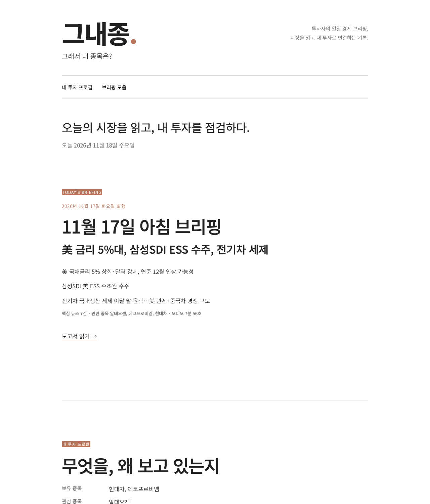
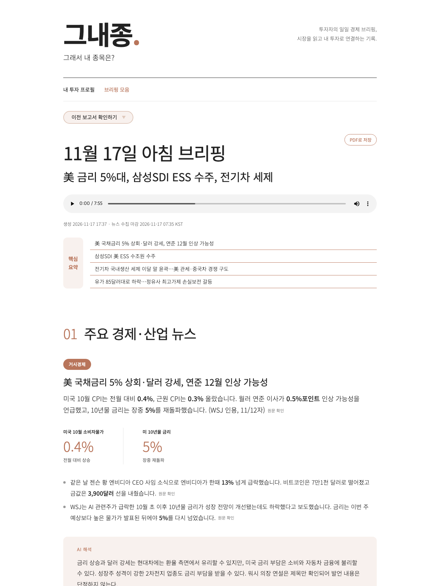
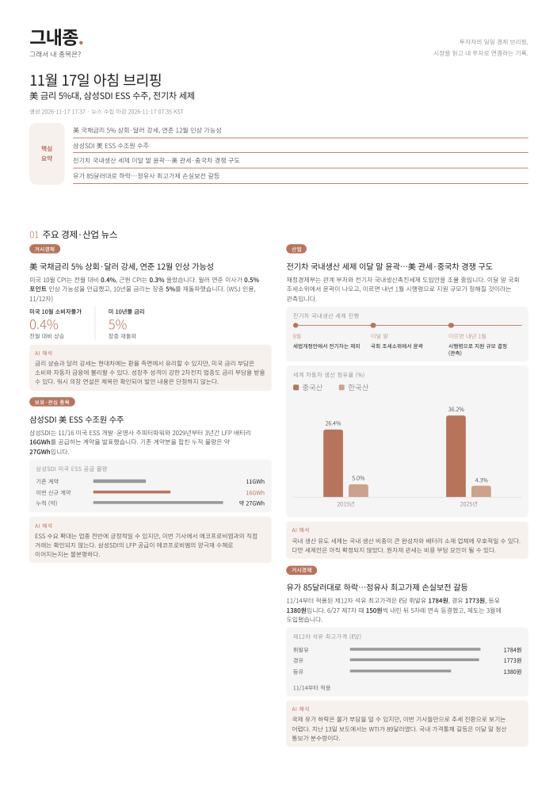
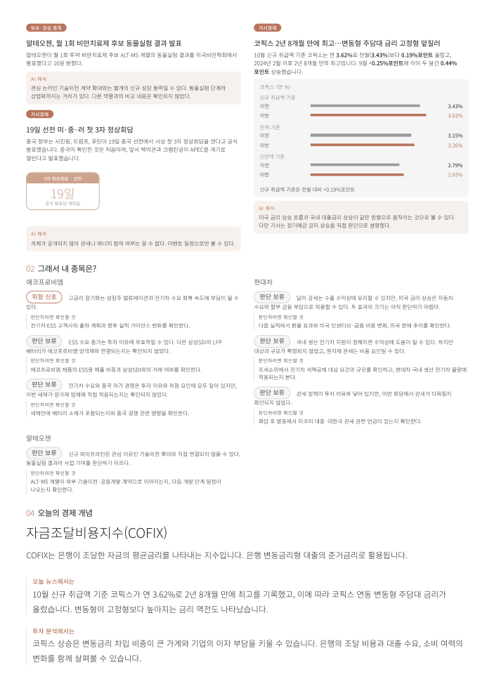
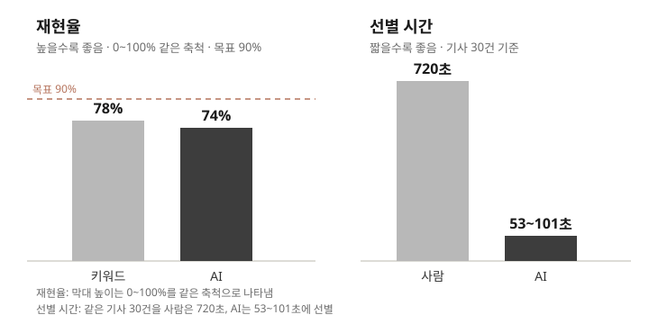

  <iframe src="https://k-im-rose.github.io/geunaejong-demo/" title="그내종 데모" loading="lazy"></iframe>

<a href="https://k-im-rose.github.io/geunaejong-demo/" target="_blank" rel="noopener">서비스 체험하기</a> · <a href="https://github.com/k-im-rose/aiffel/tree/investment-ai-briefing/investment-ai-briefing" target="_blank" rel="noopener">GitHub 보기</a>

**내 투자 이유를 이해하고, 필요한 경제 뉴스를 골라주는 AI 브리핑 서비스**

## 1. 어떤 문제에서 시작했나?

나는 국내 주식에 직접 투자하고 있다. 이전에는 경제 뉴스와 기업 공시를 꾸준히 확인했지만, AI 공부를 시작하면서 투자 정보를 챙기는 시간이 크게 줄었다.

문제는 정보가 부족한 게 아니었다. 오히려 너무 많았다.

구글 키워드 알림도 사용해 봤지만, 관련 없는 기사가 자주 섞였다. 필요한 정보를 골라내는 일이 번거로워 결국 몇 주 지나지 않아 알림을 열어보지 않게 됐다.

그러다 이런 생각이 들었다.

**내가 어떤 종목을 가지고 있는지만이 아니라, 왜 투자했는지까지 아는 AI가 뉴스를 골라준다면 어떨까?**

특정 기업의 이름이 기사에 등장하지 않아도, 그 기업이 속한 산업의 정책이나 시장 변화는 투자 판단에 중요할 수 있다.

경제 뉴스를 모두 읽지 않아도 내 투자와 연결되는 정보를 놓치지 않는 방법을 만들고 싶었다.

## 2. 누구를 위한 서비스인가?

나처럼 직접 투자하고 있지만, 매일 수많은 경제 뉴스를 확인하기 어려운 개인 투자자를 위한 서비스다.

특히 정보를 찾고 읽는 데 별도의 시간을 내기 어려운 사람을 생각했다.

나는 평소 아침에 씻고 준비하면서 경제 뉴스나 주식 관련 콘텐츠를 틀어놓곤 했다. 화면을 계속 보지 않아도 새로운 소식을 접할 수 있다는 점이 좋았다.

반면 글로 된 뉴스는 직접 기사를 찾고, 클릭하고, 읽어야 한다. 보유한 종목이 여러 개라면 관련 뉴스를 하나씩 확인하는 것도 일이다.

**그래서 읽어야 하는 뉴스보다, 알아서 골라주고 들려주는 뉴스가 필요했다.**

사용자가 보유·관심 종목과 투자 이유를 등록하면 AI가 관련 뉴스를 선별하고, 아침 준비나 이동 중에도 들을 수 있도록 음성 브리핑을 제공하는 방식이다.

<figure class="shot">
  
  <figcaption>메인 화면. 오늘의 브리핑을 요약하고, 아래에서 내 투자 프로필(보유·관심 종목과 투자 이유)을 확인하고 고친다.</figcaption>
</figure>

음성은 남녀 두 진행자가 대화를 나누는 형태로 구성했다. 한 사람이 뉴스를 계속 읽는 것보다 질문과 답변이 오가는 방식이 덜 지루하고, 어려운 경제 내용도 자연스럽게 풀어낼 수 있을 것이라 생각했다.

## 3. 어떻게 해결했나?

기존에 사람이 하던 과정을 수집, 선별, 분석, 전달로 나누고 AI를 적용했다.

| 기존 방식 | 바꾼 방식 |
|---|---|
| 경제지와 포털을 직접 확인 | 여러 출처의 뉴스를 수집 |
| 제목과 키워드로 관련 기사 찾기 | 투자 이유와 위험 요인을 기준으로 AI가 선별 |
| 뉴스를 읽고 종목 영향을 직접 정리 | AI가 관련성과 확인할 사항을 분석 |
| 읽을 시간을 따로 확보 | 두 진행자의 대화형 음성 브리핑 생성 |
| 중요한 내용을 별도로 기록 | 날짜별 보고서, 메모, 점검 목록으로 관리 |

### 투자 이유를 중심으로 뉴스 연결하기

종목 이름이 들어간 기사뿐 아니라 산업, 정책, 거시경제 변화도 함께 살펴보도록 설계했다.

각 뉴스가 기존 투자 이유를 뒷받침하는지, 위험을 높이는지, 아직 판단하기 어려운지를 구분한다.

무조건 수혜·피해를 단정하지 않고, 추가로 확인해야 할 사항을 함께 보여주도록 했다.

### 듣는 브리핑과 읽는 보고서

정보를 전달하는 방식도 중요하게 생각했다.

음성 브리핑은 남녀 두 진행자가 질문과 답변을 주고받는 형식으로 구성했다. '무슨 일이 있었는지 → 왜 중요한지 → 어떤 산업에 영향을 주는지 → 그래서 내 종목은 어떤지' 순서로 설명한다.

한 명이 계속 읽는 뉴스보다 대화 형식이 더 자연스럽게 들릴 것이라고 판단했다. 어려운 내용은 한 진행자가 질문하고 다른 진행자가 풀어 설명하도록 했다.

음성으로 들었던 내용을 자세히 확인하고 싶을 때는 웹 보고서를 열어볼 수 있다.

보고서에는 주요 경제·산업 뉴스, 내 종목에 미치는 영향, 추가 뉴스, 경제 개념과 퀴즈를 넣었다. 내 생각을 기록하거나 나중에 점검할 사항을 저장하는 기능도 만들었다.

<figure class="shot">
  
  <figcaption>웹 보고서 상단. 핵심 요약과 주요 뉴스가 먼저 나오고, 종목별 영향과 AI 해석이 이어진다. 음성 플레이어도 함께 있다.</figcaption>
</figure>

### 보고서를 신문처럼 디자인하기

웹에서만 읽는 보고서가 아니라, 필요한 내용을 PDF로 저장할 수 있도록 했다.

PDF는 별도의 편집 프로그램 없이 A4 한두 쪽의 신문형 보고서로 정리된다.

핵심 요약, 주요 뉴스, 종목별 영향, 경제 개념을 중심으로 배치하고, 음성 플레이어와 퀴즈 등 인쇄에 불필요한 요소는 제외했다.

<figure class="shot">
  

    
    
  

  <figcaption>PDF 1쪽(왼쪽)과 2쪽(오른쪽). 1쪽에는 핵심 요약과 주요 뉴스를, 2쪽에는 종목별 영향과 경제 개념을 배치했다. 음성 플레이어와 퀴즈는 빠졌다.</figcaption>
</figure>

웹에서는 정보를 탐색하고 기록할 수 있도록, PDF에서는 핵심 내용을 한눈에 읽을 수 있도록 각각의 목적에 맞춰 화면을 구성했다.

## 4. 어떻게 검증했나?

이번에는 단순히 서비스가 작동하는지 확인하는 데서 끝내지 않았다.

**AI가 기존 키워드 방식보다 뉴스를 더 잘 골라낼 수 있는지** 직접 비교했다.

실제 기사 30건을 대상으로 AI 결과를 보기 전에 관련 여부를 판단해 정답을 만들었다. 이후 키워드 방식과 AI 모델의 결과를 비교했다.

### 뉴스 선별 성능 비교

| 평가 항목 | 키워드 | AI |
|---|---:|---:|
| 재현율 | 78% | 74% |
| 정밀도 | 96% | 95% |
| 놓친 관련 기사 | 6건 | 7건 |
| 잘못 포함한 기사 | 1건 | 1건 |

<figure class="shot">
  
  <figcaption>왼쪽은 재현율, 오른쪽은 선별 시간이다. AI는 시간을 크게 줄였지만 재현율은 키워드 방식보다 낮았다.</figcaption>
</figure>

사전에 목표로 정한 재현율 90%에는 도달하지 못했다. AI가 키워드 방식보다 더 정확하게 선별한다는 가설도 입증하지 못했다.

다만 같은 30건을 선별하는 데 사람이 720초 걸린 반면, AI는 53~101초가 걸렸다.

속도 개선 가능성은 확인했지만, 중요한 뉴스를 놓치지 않는 정확도는 더 개선해야 한다는 결론을 얻었다.

### AI의 분석 결과도 검증했다

처음 생성된 브리핑을 검토하면서 출처가 잘못 연결되거나, 기사에 없는 기업 실적 수치가 포함된 문제를 발견했다.

AI가 출처 링크를 제시했다고 해서 그 내용이 반드시 맞는 것은 아니었다.

그래서 기사 본문과 AI의 주장을 대조하는 과정을 추가했다. 근거가 확인되지 않은 숫자와 설명은 수정하거나 제외하고, 출처와 주장이 일치하는지 다시 검사했다.

최종 공개 데모에서는 사실 주장 23개 중 연결된 출처와 어긋난 주장이 0건이었다. 다만 이는 수집한 출처와의 일치 여부를 확인한 것이며, 모든 사실을 독립적으로 검증했다는 뜻은 아니다.

**AI가 만든 결과를 그대로 믿기보다, 어떤 기준으로 검증해야 하는지 설계하는 것이 중요했다.**

## 5. 앞으로 어떻게 발전시킬 계획인가?

그내종은 과제 제출을 위해 시작했지만, 앞으로 내가 실제로 사용할 서비스로 발전시킬 계획이다.

현재는 가상 투자자 프로필과 실제 뉴스를 활용한 데모를 공개한 상태다. 뉴스 수집부터 분석, 음성 브리핑 생성까지 구현했지만, 매일 자동으로 실행되는 서비스는 아직 아니다.

앞으로 실제 투자 정보를 연결하고, **매일 오전 7시 30분에 새로운 브리핑을 받아볼 수 있도록 자동화**하려고 한다.

추가로 개선하고 싶은 부분도 있다.

- **뉴스 선별 정확도 개선:** 키워드 방식과 AI 분석을 결합해 중요한 기사를 놓치는 문제 줄이기
- **증권사 API 연동:** 실제 보유 종목과 투자 정보를 자동으로 불러와 수동 입력 최소화하기
- **정보의 신뢰도 강화:** 기업 공시와 공식 경제지표를 연결해 분석 근거 보완하기
- **투자 기록 관리:** 종목별 투자 이유와 이전 판단, 점검 기록을 지속적으로 관리하기

현재는 다른 프로젝트와 학습을 병행하고 있어 추가 개발을 잠시 미뤄둔 상태다.

우선 내가 매일 사용할 수 있는 형태로 완성하고, 실제 이용하면서 정확도와 편의성을 개선할 생각이다. 이후 상용화까지 고려한다면 증권사 API 연동과 사용자별 데이터 관리 기능도 필요할 것이다.

**매일 아침 별도로 뉴스를 검색하지 않아도, 내 투자에 필요한 정보를 가볍게 들으며 하루를 시작하는 것.** 그내종을 통해 만들고 싶은 경험이다.
