

  <iframe src="https://office-reset-seven.vercel.app/" title="잠깐만 휴식" loading="lazy"></iframe>

<a href="https://office-reset-seven.vercel.app/" target="_blank" rel="noopener">서비스 체험하기</a> · <a href="https://github.com/meet-in-dungeon/office-reset" target="_blank" rel="noopener">GitHub 보기</a>

4인 팀으로 참여한 3일간의 해커톤 프로젝트다. 나는 두 가지 역할을 맡았다. 하나는 팀을 이끌고 일을 나누는 **팀장(PM)**, 다른 하나는 서비스 화면을 만드는 **디자이너**다. 메인과 온보딩 화면 개발도 함께 맡았다.

## 1. 처음으로 혼자가 아닌 팀으로 만들다

AI를 배우기 시작한 이후 여러 서비스를 만들어 왔다. 대부분 일상에서 느낀 불편함을 해결하기 위해 혼자 기획하고 개발한 프로젝트였다.

이번에는 달랐다. 4명의 팀원이 함께 서비스를 기획하고 개발하는 3일간의 해커톤에 참여했다.

팀장을 맡게 되었지만 마음이 가볍지만은 않았다. 내가 오랫동안 일해 온 전문 분야가 아닌 개발 분야에서 팀을 이끌어야 했기 때문이다.

기술적으로 모든 것을 알 수는 없었다. 대신 내가 기존에 일을 하면서 중요하게 생각했던 방식으로 프로젝트를 시작했다.

**문제를 먼저 정의하고, 해결 방법을 정하고, 각자가 잘할 수 있는 일을 나누는 것.**

그렇게 우리의 첫 팀 프로젝트가 시작되었다.

## 2. 건강관리의 필요성을 알면서도 실천하지 못하는 사람들

아이디어는 팀원들의 실제 경험에서 시작되었다.

팀원 모두 부상이나 신체적 통증을 경험한 적이 있었다. 병원에서 한 시간에 한 번씩 일어나 스트레칭을 하라는 권유를 받았지만, 일에 집중하다 보면 금세 잊어버렸다.

반면 현재 참여하고 있는 교육과정에서는 50분마다 알림 종이 울린다. 그 소리를 들으면 자연스럽게 자리에서 일어나 몸을 움직이게 되었다.

여기서 하나의 문제를 발견했다.

**건강관리의 필요성을 모르는 것이 아니라, 실천할 계기가 부족한 것이 아닐까?**

장시간 앉아서 일하는 직장인을 대상으로 업무 중 짧은 스트레칭과 호흡을 실천할 수 있는 서비스를 만들기로 했다. 사무실 자리에서 바로 따라 할 수 있도록, 스트레칭은 의자에 앉아서 할 수 있는 동작만 넣었다.

그렇게 탄생한 서비스가 '잠깐만 휴식'이다.

## 3. 만들기 전에 무엇을 만들지 정했다

주어진 시간은 단 3일이었다.

빠르게 개발을 시작하는 것도 중요했지만, 각자가 서로 다른 방향으로 개발하면 오히려 더 많은 시간이 필요할 것이라 생각했다.

그래서 첫날은 코드를 한 줄도 쓰지 않고 하루 종일 기획 회의만 했다. 회의는 팀장인 내가 주도했다. 문제 정의, 경쟁 서비스, 사용자 흐름, 필수 기능, 기술, 디자인, 업무 분담까지 일곱 단계로 나누고, 단계마다 "무엇이 정해지면 끝인지" 완료 기준을 적었다.

팀원들과 먼저 해결할 문제와 사용자를 정의했다. 기존 서비스들을 살펴보고, 우리가 만들 서비스에 필요한 기능을 논의했다.

기능을 많이 넣는 것보다 정해진 시간 안에 실제로 사용할 수 있는 서비스를 완성하는 것이 중요했다.

우리가 설계한 핵심 사용자 경험은 다음과 같다.

**알림 → 실천 → 보상 → 기록 → 반복**

- 출퇴근 및 점심시간에 맞춘 스트레칭 알림
- 사무실에서 할 수 있는 12가지 스트레칭 동작
- 한 번에 3개 동작을 수행하는 짧은 루틴
- 하루 마지막 루틴의 호흡
- 업무 중 스트레스를 위한 '빡침 버튼'
- 반복 실천을 돕는 배지와 등급 시스템
- 실천 기록 및 주간 통계

기능의 필요성과 구현 가능성을 함께 고려하며 범위를 정했다.

개발에 들어가기 전에 사용자가 하루 동안 쓰는 흐름도 먼저 설계했다.

<figure class="shot">
  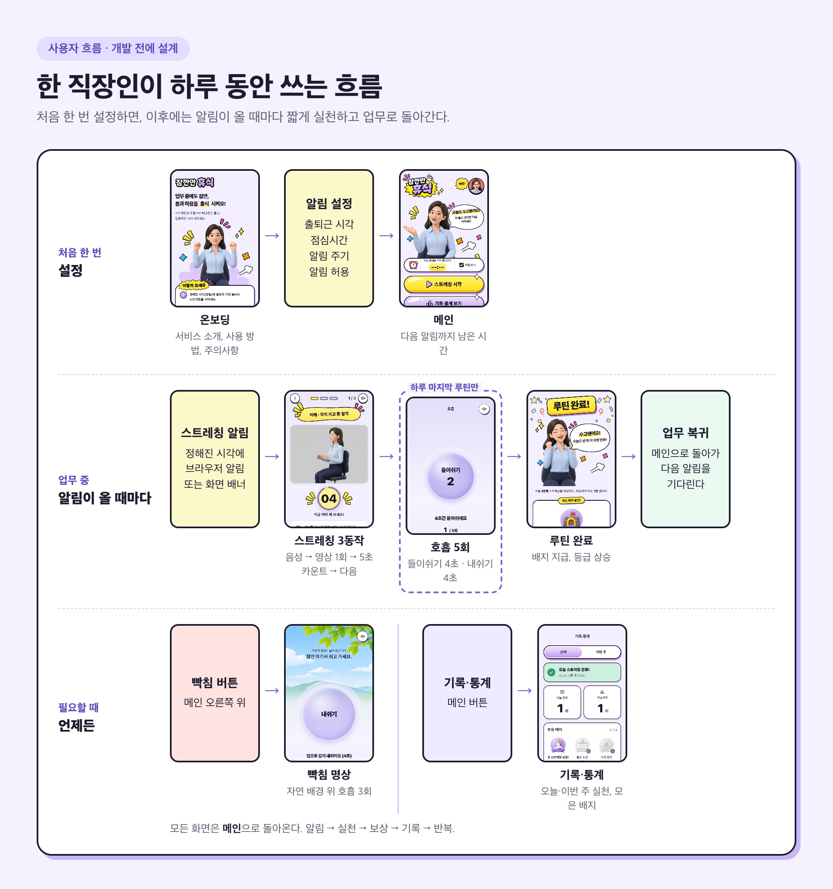
  <figcaption>앱 사용 흐름. 처음 한 번 설정하고, 업무 중에는 알림이 올 때마다 짧게 실천한 뒤 메인으로 돌아온다.</figcaption>
</figure>

<figure class="shot">
  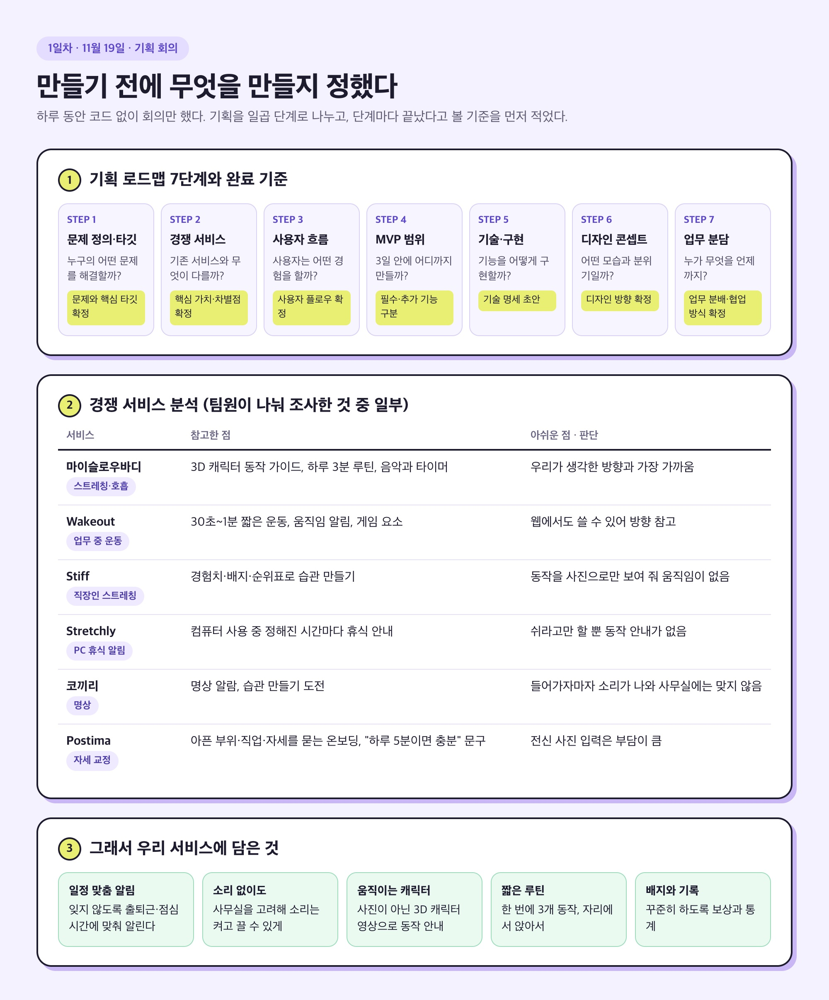
  <figcaption>1일차 기획 회의 내용을 노션에서 옮겨 정리했다. 단계별 완료 기준과 경쟁 서비스 분석, 거기서 가져온 방향.</figcaption>
</figure>

## 4. 문제마다 기능으로 답했다

기획 회의에서 팀원들과 정의한 문제는 다음과 같다.

- 업무에 몰입하면 쉬어야 할 때를 놓친다.
- 따로 시간을 내서 스트레칭하는 것이 부담스럽고 귀찮다.
- 어떤 동작을 해야 할지 모르고, 잘못하면 다칠까 걱정된다.
- 사무실에서 다른 사람의 눈이 신경 쓰인다.
- 업무 중 쌓인 스트레스를 바로 풀 곳이 없다.
- 필요한 줄 알면서도 꾸준히 하지 못한다.

기능은 이 문제들에 하나씩 답하는 방식으로 정했다.

**쉬어야 할 때를 놓친다 → 일정에 맞춘 알림.** 출퇴근 시간, 점심시간, 알림 주기를 설정하면 그 사이에 알림을 보낸다. 알림을 누르면 바로 스트레칭 화면이 열린다.

<figure class="shot">
  

    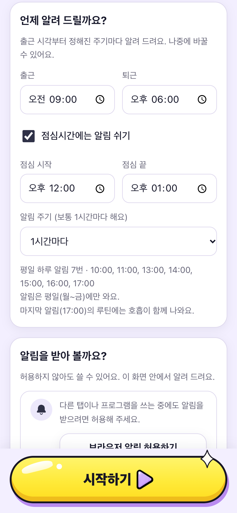
    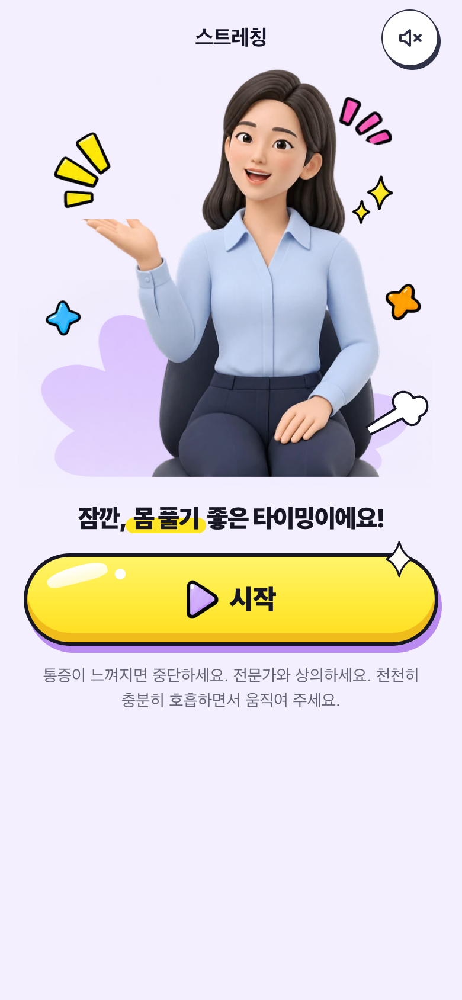
  

  <figcaption>알림 설정(왼쪽)과 알림을 누르면 열리는 스트레칭 시작 화면(오른쪽).</figcaption>
</figure>

**시간 내기가 부담스럽다 → 3개 동작의 짧은 루틴.** 한 번에 3개 동작만 한다. 자리에서 일어나지 않고 의자에 앉아서 할 수 있는 동작으로만 골랐다.

**어떤 동작인지 모르겠다 → 영상, 음성, 글 안내.** 캐릭터 영상과 동작 이름 음성, 단계별 설명과 주의사항을 함께 보여 준다. 동작을 먼저 본 뒤에 카운트다운이 시작된다.

**사무실 눈치가 보인다 → 소리 켜고 끄기.** 소리는 기본으로 꺼져 있고, 스트레칭과 명상 화면에서 바로 켜고 끌 수 있다.

**스트레스를 풀 곳이 없다 → 빡침 버튼.** 몸의 피로뿐 아니라 업무와 사람 사이에서 생기는 스트레스도 다루고 싶었다. 메인 화면 오른쪽 위 빡침 버튼을 누르면 자연 풍경 위에서 짧게 세 번 숨을 쉬는 명상 화면이 열린다. 스트레칭 알림을 기다리지 않고, 화가 난 그 순간에 바로 쓸 수 있게 했다.

<figure class="shot">
  

    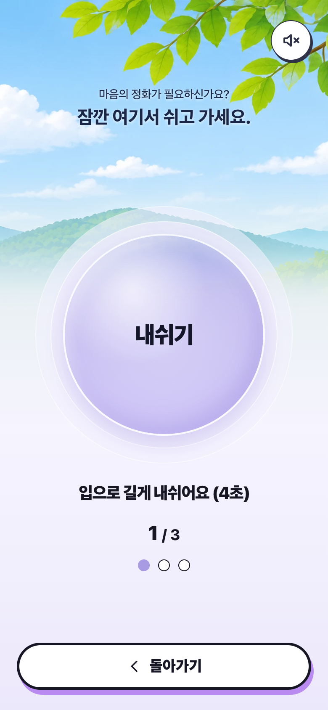
    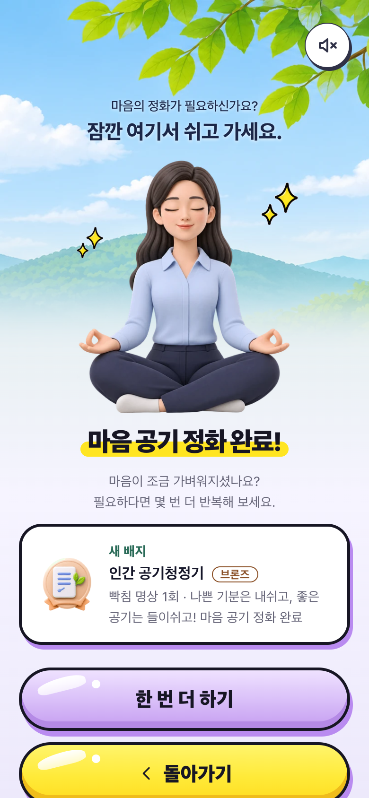
  

  <figcaption>빡침 명상(왼쪽)과 명상 완료(오른쪽). 세 번 숨을 쉬고 나면 배지를 받고, 필요하면 한 번 더 할 수 있다.</figcaption>
</figure>

**꾸준히 하지 못한다 → 배지와 기록.** 루틴을 마치면 배지를 받고, 같은 배지도 브론즈·실버·골드로 올라간다. 기록·통계 화면에서 오늘 한 횟수와 이번 주 실천 현황을 볼 수 있다.

<figure class="shot">
  

    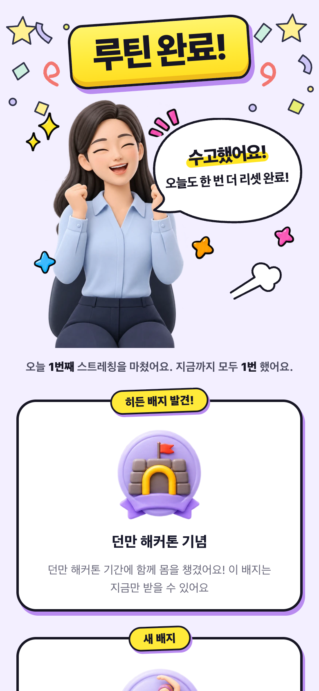
    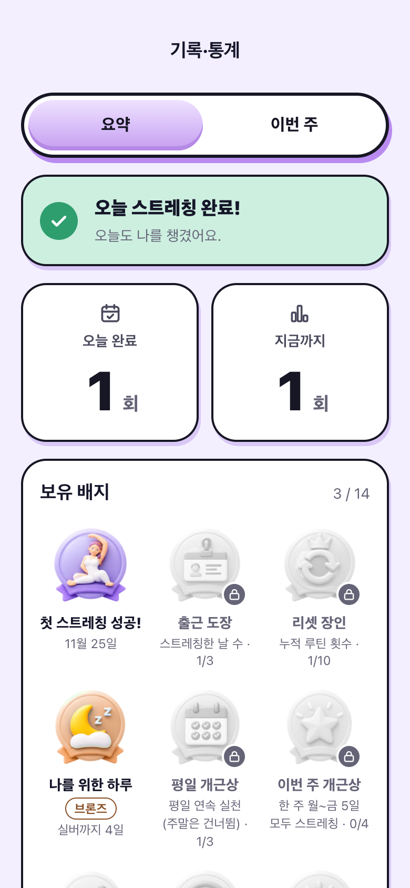
  

  <figcaption>루틴 완료(왼쪽)와 기록·통계(오른쪽).</figcaption>
</figure>

### 넣지 않은 기능도 정했다

만들 수 있는 기능이라도 사무실에서 쓰기 불편하면 넣지 않았다.

- **웹캠 자세 인식.** 처음에는 고려했다. 하지만 사무실에서 카메라를 켜고 스트레칭하는 것 자체가 부담이 될 수 있다고 봤다.
- **회원가입.** 잠깐 몸을 풀려고 들어왔는데 가입부터 해야 하면 그 과정이 귀찮다. 가입 없이 바로 시작하게 했다.
- **랭킹.** 다른 사람과 겨루는 서비스가 아니라 쉬려고 쓰는 서비스다. 순위 대신 자기 실천이 쌓이는 배지를 골랐다.

## 5. 팀장으로서: 네 사람이 동시에 개발할 수 있는 환경을 만들다

개인 프로젝트와 팀 프로젝트의 가장 큰 차이는 내가 만든 코드가 다른 사람의 작업에도 영향을 준다는 점이었다.

팀장으로서 내가 할 일은 직접 코드를 많이 쓰는 것보다, 네 사람이 서로 부딪히지 않고 각자 일에 집중할 수 있게 만드는 것이라고 생각했다.

GitHub 저장소 준비, 협업 규칙, 업무 분배까지는 내가 혼자 맡았다. 그 뒤부터는 네 사람이 각자 브랜치에서 개발하고, PR로 서로의 작업을 확인하며 함께 진행했다.

### 업무 나누기: 누가, 무엇을, 어디까지

팀원들의 강점을 고려해 기능 단위로 업무를 나눴다. 한 사람이 한 기능의 화면과 동작을 함께 맡는 방식이다.

| 담당 | 맡은 일 |
|---|---|
| 나 | 기획과 진행 관리, 공통 화면 구조, 디자인, 메인·온보딩 화면, 알림 |
| 팀원 A | 12개 스트레칭 동작 선정과 스트레칭 실행 화면, 호흡 |
| 팀원 B | 3D 캐릭터 스트레칭 영상, 음성 안내와 배경음악, 배포 |
| 팀원 C | 배지와 기록 저장, 루틴 완료·통계 화면, 빡침 명상 |

업무를 나눌 때 세 가지를 함께 적었다.

- **1차 필수와 2차로 미룰 일.** 시간이 부족해도 서비스의 처음과 끝이 이어지도록, 먼저 끝내야 할 일과 나중에 할 일을 나눴다.
- **완료 기준.** "화면을 만든다"가 아니라 "버튼을 누르면 담당 화면으로 이동한다"처럼, 끝났는지 확인할 수 있는 문장으로 적었다.
- **연결할 내용.** 누가 누구에게 무엇을 넘겨야 하는지 적었다. 예를 들어 동작 이름이 정해져야 영상 파일 이름을 맞출 수 있고, 루틴이 끝나야 배지를 줄 수 있다.

시간이 가장 오래 걸리는 영상 제작은 12개가 모두 완성되기를 기다리지 않기로 했다. 동작 하나로 전체 흐름이 돌아가는지 먼저 확인하고, 나머지를 채워 넣는 방식으로 진행했다.

### 협업 규칙: 모두가 같은 방식으로 일하게

GitHub Organization을 만들고 공통 저장소를 준비했다. 모두가 같은 방식으로 작업할 수 있도록 Branch, Pull Request, Merge 같은 용어를 쉬운 말로 풀어 공유했다.

각자 작업 브랜치에서 개발하고, Pull Request를 통해 변경사항을 공유했다. 팀원이 작업 내용을 검토하고 승인한 후 코드를 합치는 방식으로 진행했다.

PR 규칙도 따로 정했다. PR이 하나 올라올 때마다 누군가의 작업이 멈추기 때문이다.

- PR은 작업 하나가 끝났을 때만 올린다.
- 하루 리뷰 당번을 정해, 당번 한 명이 그날 PR을 모아서 확인한다.
- 리뷰는 하루 두 번 정해진 시간에 한다.
- 20~30분 넘게 풀리지 않는 문제는 혼자 붙잡지 말고 바로 공유한다.

팀원 모두 AI로 개발했기 때문에, 사람뿐 아니라 AI도 같은 규칙을 따르게 했다. 이 방법은 7장에 따로 정리했다.

### 내가 담당한 영역

- 프로젝트 전체 기획 및 진행 관리
- 회의 진행 및 주요 의사결정
- 팀원별 업무 분배 및 작업 범위 설정
- GitHub 협업 환경 및 작업 규칙 설계
- 서비스의 전체 UI/UX 디자인
- 메인 화면 및 온보딩 화면 개발
- 공통 디자인 요소와 이미지 에셋 제작
- 전체 화면의 디자인 검수 및 개선
- 팀원 간 코드 통합 과정과 기능 검증 참여

혼자 개발할 때는 크게 체감하지 못했던 PR과 Merge의 필요성을 실제 협업 과정에서 이해할 수 있었다.

<figure class="shot">
  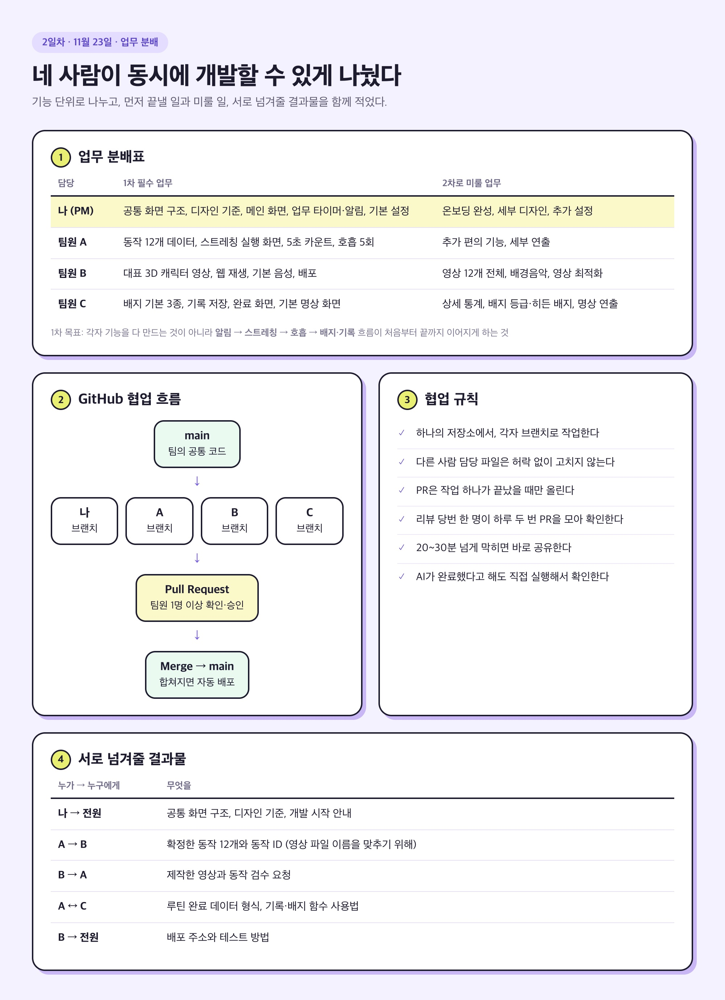
  <figcaption>2일차에 정리한 업무 분배와 협업 방식. 노션의 업무 분배 문서를 옮겨 정리했고, 팀원 이름은 A·B·C로 바꿨다.</figcaption>
</figure>

## 6. 디자이너로서: 건강관리를 조금 더 유쾌하게

서비스의 디자인도 담당했다.

건강관리라는 단어는 다소 진지하고 무겁게 느껴진다. 하지만 우리가 만들고 싶었던 것은 직장인이 부담 없이 반복해서 사용할 수 있는 서비스였다.

그래서 친근한 3D 캐릭터에 2D 카툰 스타일을 결합했다.

이 스타일을 고른 이유는 세 가지다.

첫째, 건강관리를 의무처럼 느끼지 않게 하고 싶었다. 건강 앱은 '해야 하는 일'로 느껴지기 쉽고, 알림이 잔소리처럼 들리면 결국 알림을 끄게 된다. 웃음이 나는 캐릭터와 문구로 알림을 '잠깐 쉬어 가자'는 신호로 받아들이게 하고 싶었다.

둘째, 직장인이 실제로 느끼는 감정을 대신 말해 주고 싶었다. 사무복을 입고 의자에 앉은 직장인 캐릭터와 '빡침 버튼'처럼 업무 중 감정을 조금 과장해서 보여 주면, 사용자가 자기 이야기처럼 느끼고 한 번 더 눌러 볼 것이라고 생각했다.

셋째, 업무 중에 잠깐 여는 앱이라 한눈에 알아볼 수 있어야 했다. 굵은 외곽선, 큰 버튼, 분명한 색 대비로 무엇을 눌러야 하는지 바로 보이게 했다. 동작을 보여 주는 캐릭터는 기획 회의에서 "3D가 보기 편하다"는 의견이 나와 3D로 정했다.

다만 B급 감성은 빡침 버튼, 배지와 보상, 루틴 완료, 캐릭터 반응처럼 감정이 드러나는 순간에만 썼다. 앱 전체가 장난스러우면 동작 안내나 주의사항까지 가볍게 보일 수 있어서, 기본 화면은 깔끔하게 두었다.

직장인 캐릭터는 영상을 맡은 팀원이 스트레칭 영상용으로 만든 3D 캐릭터다. 사용자가 자기 모습처럼 느끼도록 일부러 사무복을 입히고 사무실 의자에 앉은 모습으로 정했다. 나는 이 캐릭터를 바탕으로 환영, 안내, 축하, 빡침, 편안함을 나타내는 표정 이미지 5종을 만들어 메인, 온보딩, 명상, 빡침 버튼 등 화면 곳곳에 배치했다. 메인 화면에서 캐릭터가 둥실 떠오르는 것처럼 화면마다 반복되는 움직임도 넣었다.

여기에 어울리도록 로고, 말풍선, 별, 강조선, 스티커, 버튼 등 2D 카툰 요소를 디자인했다. 반복 실천의 재미를 더하기 위한 배지 에셋도 제작했다.

스트레칭을 시작하거나 루틴을 완료하는 화면은 밝고 유쾌하게, 호흡에 집중하는 화면은 차분하게 구성했다. 기록과 통계 화면에서는 장식을 줄이고 정보 전달을 우선했다.

같은 서비스 안에서도 사용자가 어떤 행동을 하는 순간인지에 따라 디자인의 강약을 다르게 적용했다.

<figure class="shot">
  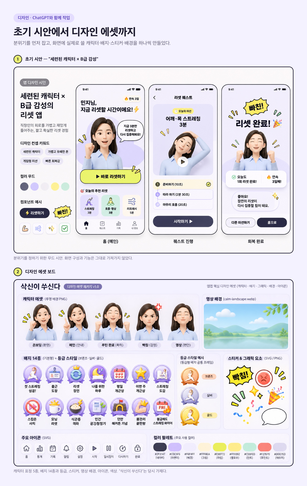
  <figcaption>위는 분위기를 정하기 위한 초기 시안, 아래는 실제로 화면에 쓴 디자인 에셋이다. 에셋 보드의 "삭신이 쑤신다"는 당시 가제다.</figcaption>
</figure>

## 7. AI와 일하는 방식

이번 프로젝트에서는 AI를 그냥 쓰는 것보다, AI가 어떤 기준으로 일하게 할지 정하는 데 시간을 많이 썼다. 팀원 네 명이 각자 AI로 개발하는 상황이었기 때문이다.

### 팀의 결정을 저장소 문서로 남겼다

회의에서 정한 내용은 노션에 있었다. 팀원마다 AI에게 노션 자료를 찾아 읽으라고 따로 지시하지 않아도, AI가 작업을 시작할 때 바로 참고할 수 있어야 했다. 그래서 회의록, 업무 분배, 최종 확정 사항을 저장소 안의 문서로 옮겼다.

자료끼리 내용이 다를 때를 대비해 어떤 문서가 우선인지도 정했다. 가장 최근에 확정한 사항을 정리한 문서가 가장 먼저다. 이렇게 하면 AI가 오래된 회의 내용을 보고 엉뚱하게 만드는 일을 줄일 수 있다.

### 모든 팀원의 AI가 같은 규칙을 따르게 했다

공통 규칙 파일(AGENTS.md)을 만들어 저장소에 넣었다. 누가 어떤 AI를 쓰든 작업 범위, 테스트, 보안 규칙을 같은 기준으로 지키게 하기 위해서다.

여기에 더해 팀원별로 AI에게 처음 붙여 넣을 프롬프트를 만들어 나눠 줬다. 내용은 다음과 같다.

- 작업 전에 규칙 문서를 먼저 읽고, 오늘 할 일과 수정해도 되는 파일을 쉬운 말로 설명할 것
- 본인 담당 파일만 고칠 것. 다른 사람 파일에서 문제가 보이면 직접 고치지 말고, 담당자에게 전달할 문장만 써 줄 것
- 각 업무 담당자가 "작업이 끝났다"고 말하기 전에는 PR을 만들지 말 것
- 다른 팀원의 기능이 아직 없으면 기다리지 말고 샘플 데이터로 먼저 시험해 볼 것

AI가 다른 사람의 코드를 마음대로 고치면 팀 전체 작업이 꼬인다. 그래서 AI가 할 수 있는 일과 하면 안 되는 일을 먼저 정해 두었다. AI가 "완료했다"고 해도 직접 실행해서 확인한다는 원칙도 함께 정했다.

### 정해지지 않은 것은 AI가 정하지 않게 했다

AI는 빈칸이 있으면 그럴듯하게 채워 넣는다. 그래서 디자인을 맡길 때는 서비스 정보와 화면 구성을 정리한 문서를 따로 만들고, "확정"과 "미정"을 나눠 적었다. 미정인 부분은 임의로 정하지 말고 임시로 두게 했다.

참고용 시안 이미지도 "분위기만 참고하고, 화면 구성과 기능은 그대로 가져오지 말 것"이라고 적었다. 알림 규칙처럼 문서와 코드가 다를 때는 AI가 고르지 말고 나에게 물어보게 했다.

내가 맡은 알림 기능이 그 예다. 코드를 맡기기 전에 알림 규칙 문서(ALERT_RULES)부터 썼다. 규칙과 함께 설정별로 알림이 언제 울려야 하는지 계산 예시를 표로 적었다. 예를 들어 9시 출근, 18시 퇴근, 1시간 주기인 기본 설정이면 10·11·13·14·15·16·17시, 하루 7번이다. AI가 만든 알림 코드는 이 표와 결과가 같은지 비교해 확인했다.

### AI에게도 서로 다른 역할을 부여했다

디자인 작업에는 두 가지 AI를 활용했다.

처음에는 하나의 AI에게 디자인과 개발을 모두 요청했다. 하지만 내가 원하는 디자인과 실제 구현된 화면 사이에 차이가 있었다.

그래서 사람과 AI의 역할을 구분했다.

- **나:** PM 및 최종 의사결정자
- **ChatGPT:** UI/UX 디자이너
- **Claude Code:** 개발자

ChatGPT와 디자인 방향을 논의하고 시안을 제작했다. 디자인을 확정하면 구체적인 구현 명세와 이미지 에셋을 Claude Code에 전달했다.

Claude Code가 구현한 화면을 스크린샷으로 확인하고, 다시 ChatGPT와 디자인을 검수했다.

**디자인 기획 → 시안 제작 → 구현 명세 → 개발 → 디자인 검수 → 개선**

이 과정을 반복하면서 내가 원하는 디자인에 가까워질 수 있었다.

복잡한 기능 구현과 코드 통합에는 Sonnet과 Opus를 활용하고, 방향이 확정된 디자인 수정에는 Haiku를 활용했다. 작업의 난이도에 맞춰 모델을 고르면서 시간과 사용량을 아꼈다.

하나의 AI에게 모든 것을 맡기기보다, 각 AI가 잘할 수 있는 일을 나누고 내가 그 사이에서 판단하는 방식이 효과적이었다.

다음에는 Claude Code의 서브 에이전트를 활용해 구현과 디자인 검수 같은 일을 AI끼리 주고받게 하고, 나는 방향을 정하고 최종 판단하는 일에 더 집중해 볼 생각이다.

<figure class="shot">
  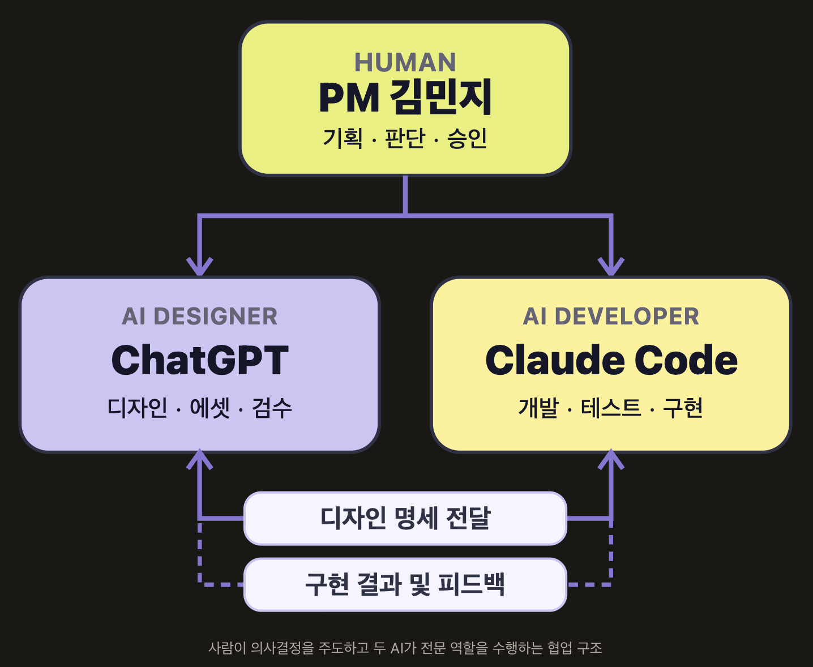
  <figcaption>사람이 의사결정을 맡고, 두 AI가 각자 역할을 맡는 협업 구조.</figcaption>
</figure>

## 8. AI가 만든 화면을 그대로 사용하지 않았다

디자인 시안을 만드는 것과 실제 서비스에 구현하는 것은 달랐다.

AI에게 시안 이미지를 전달해도 캐릭터와 말풍선의 비율이 달라지거나, 장식 요소가 한곳에 몰리는 문제가 반복해서 발생했다.

처음에는 크기를 키워 달라거나 위치를 옮겨 달라는 방식으로 요청했다. 하지만 같은 문제를 여러 번 수정해야 했다.

결국 구현에 필요한 이미지 에셋을 직접 분리해 제공하고, 화면을 하나의 좌표판처럼 정의했다.

각 요소가 어디에 위치해야 하는지, 얼마나 커야 하는지, 어떤 요소의 앞뒤에 배치되어야 하는지 수치로 전달했다.

그 이후부터 실제 구현 결과가 디자인 시안에 가까워지기 시작했다.

<figure class="shot">
  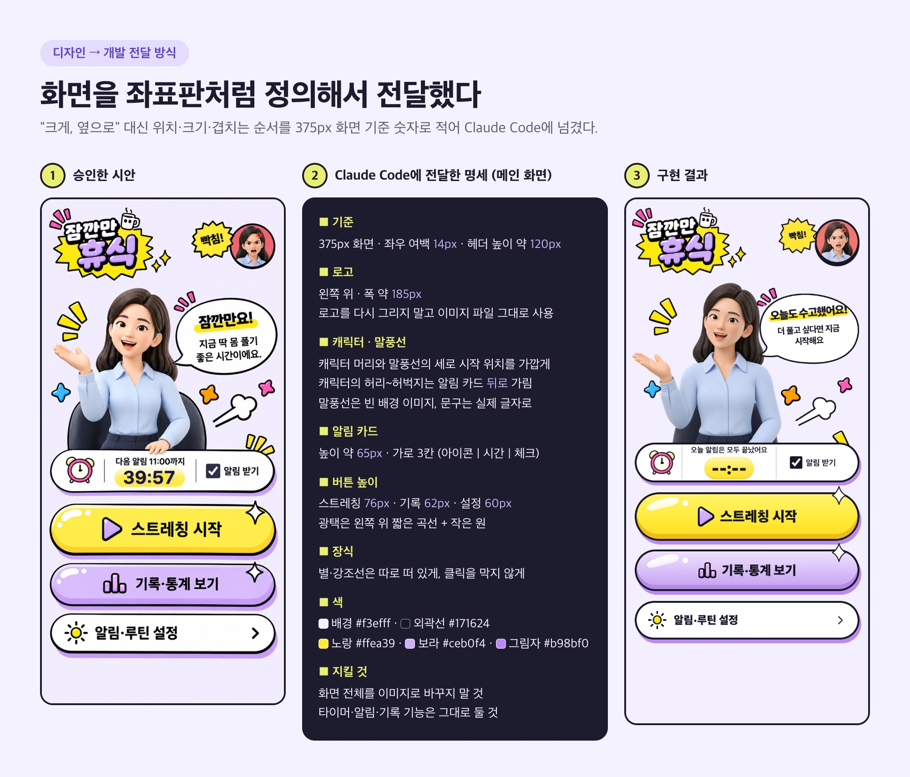
  <figcaption>메인 화면을 만들 때 전달한 명세. 승인한 시안(왼쪽)을 숫자로 풀어 쓴 명세(가운데)로 넘기고, 구현 결과(오른쪽)를 다시 확인했다.</figcaption>
</figure>

<figure class="shot">
  

    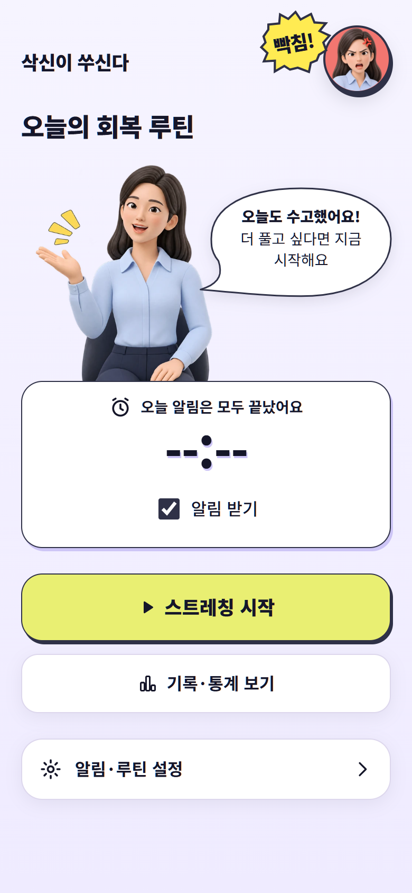
    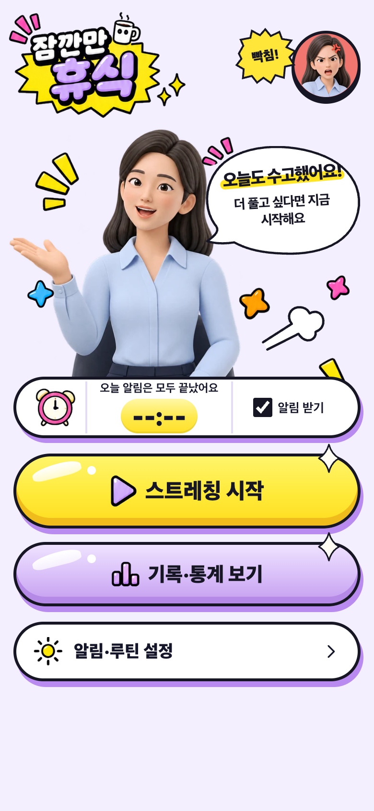
  

  <figcaption>메인 화면. 최종 디자인을 적용하기 전(왼쪽)과 후(오른쪽). 왼쪽의 서비스 이름은 당시 가제다.</figcaption>
</figure>

<figure class="shot">
  

    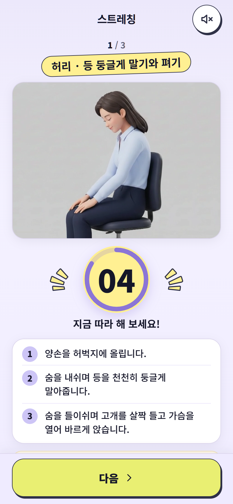
    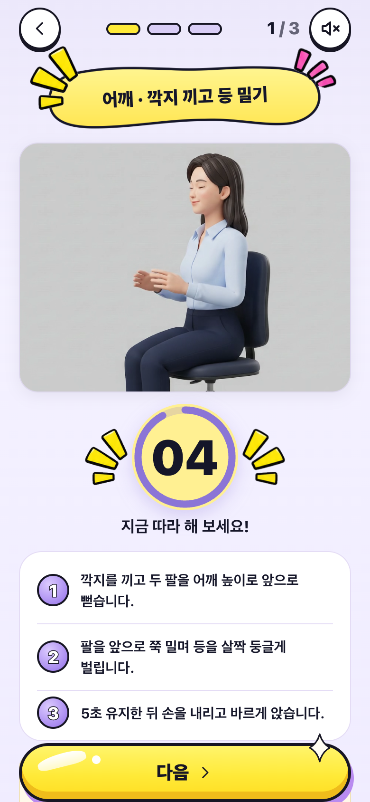
  

  <figcaption>스트레칭 화면. 최종 디자인을 적용하기 전(왼쪽)과 후(오른쪽).</figcaption>
</figure>

실제 사용 과정에서도 문제를 발견했다.

**동작을 이해하기 전에 시작되는 타이머.** 영상과 음성 안내가 끝난 후 카운트다운이 시작되도록 개선했다.

**매번 스크롤해야 누를 수 있는 다음 버튼.** 동작 설명과 안전 안내를 유지하면서 다음 버튼을 화면 하단에 고정했다.

**소리를 끄려면 설정 화면으로 돌아가야 하는 문제.** 스트레칭과 명상 화면에서 직접 소리를 켜고 끌 수 있도록 개선했다.

**페이지마다 달라지는 디자인.** 메인과 온보딩 화면을 먼저 완성한 뒤, 이를 기준으로 나머지 화면에 공통 디자인을 적용했다.

기능이 작동하는 것과 사용하기 좋은 서비스를 만드는 것은 다르다.

기획부터 디자인, 개발, 실제 사용까지 여러 단계를 경험하면서 문제를 발견하고 개선하는 과정의 중요성을 다시 느꼈다.

## 9. 3일 동안 완성한 것들

4명의 팀원이 함께 기획부터 개발, 배포까지 진행했다.

- 개인 일정에 맞춘 브라우저 알림
- 12개 스트레칭 동작과 시연 영상
- 음성 안내 및 카운트다운
- 하루 마지막 호흡 루틴
- 빡침 명상
- 14종의 배지와 등급 시스템
- 실천 기록 및 주간 통계
- 모바일 환경을 고려한 웹 서비스

<figure class="shot">
  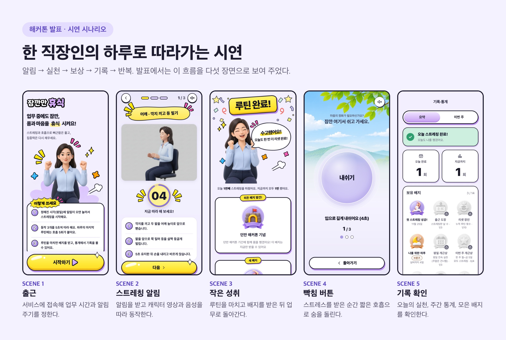
  <figcaption>발표 시연은 한 직장인의 하루를 따라가는 다섯 장면으로 구성했다.</figcaption>
</figure>

프로젝트의 결과물뿐 아니라 여러 사람이 함께 개발하는 환경을 만들고, AI와 협업하며 결과물의 품질을 개선한 과정도 나에게는 중요한 성과였다.

## 10. 첫 팀 프로젝트를 마치며

팀장을 맡았지만 기술에 대한 이해가 부족한 상태에서 팀을 어떻게 이끌어야 할지 고민이 많았다.

기획부터 충분히 논의하고 개발에 들어가자는 내 방향을 이해하고 함께해 준 팀원들에게 고마웠다. 팀원들도 일을 나누고 진행한 방식을 좋게 봐 주었다. 각자가 잘할 수 있는 영역에서 역할을 충실히 해준 덕분에 프로젝트를 마무리할 수 있었다.

모든 팀원이 AI를 활용하다 보니 서로가 AI의 아바타가 된 듯한 순간도 있었다.

AI가 작성한 요청을 충분히 이해하지 못한 채 서로에게 전달하는 경우가 있었다. AI를 활용하는 만큼 사람 간의 소통과 작업 내용에 대한 이해도 중요하다는 것을 느꼈다.

### 아쉬운 점과 다음 단계

팀원들이 직접 써 보며 고친 것과 달리, 외부 직장인이 오래 써 보는 검증은 하지 못했다.

다음에 확인하고 싶은 것은 방문자 수가 아니다. 알림을 받고 실제로 스트레칭을 시작한 비율, 루틴을 끝까지 마친 비율, 일주일 넘게 계속 쓰는 비율이다. 처음 정의한 문제가 실천의 부족이었기 때문이다.

기능을 더 넣기 전에 실제 직장인에게 먼저 써 보게 하고 싶다. 알림 횟수가 적당한지, 어떤 동작을 좋아하는지, 배지가 꾸준한 실천에 도움이 되는지 확인한 뒤에 무엇을 고칠지 정할 생각이다.

### AI로 만든 결과물과 저작권

발표 질의응답에서 저작권 질문을 받았다. 콘텐츠 대부분을 AI로 만들었는데, 저작권 문제가 생기면 서비스가 흔들리지 않느냐는 질문이었다.

우리도 이 부분을 위험 요소로 보고 있었다. AI만으로 만든 결과물은 저작권을 인정받기 어렵다는 견해가 많다. 상업적으로 쓸 수 있는 조건도 도구마다 다르다. AI가 무엇을 학습했는지를 둘러싼 논란도 아직 정리되지 않았다. AI 덕분에 빨리 만들 수 있게 된 만큼, 만든 것을 어디까지 써도 되는지 확인하는 일도 기획 단계부터 챙겨야 한다고 생각한다.

해커톤에서는 이렇게 대비했다.

- 배경음악은 AI로 만들지 않고 Pixabay에서 받았다. 상업적으로 써도 되는 라이선스인지 확인했다.
- 권한을 확인한 파일만 저장소에 올린다는 규칙을 정했다.
- 이미지와 영상은 같은 이름의 파일로 바꿔 넣기만 하면 화면에 반영되게 만들었다. 교체할 때 코드를 거의 고치지 않아도 된다.

지금 결과물은 해커톤 시연용이다. 정식으로 출시한다면 사용한 AI 도구의 상업적 이용 약관을 다시 확인할 것이다. 캐릭터처럼 서비스의 얼굴이 되는 부분은 직접 제작하거나 외주로 바꿀 생각이다.

### 돌아보며

개인적으로 가장 만족스러웠던 것은 AI마다 역할을 부여하고 협업하는 방식을 직접 경험한 것이다.

앞으로는 AI에게 일을 잘 요청하는 것뿐 아니라, 사람과 AI가 함께 일하는 방식 자체를 더 잘 설계하고 싶다.
