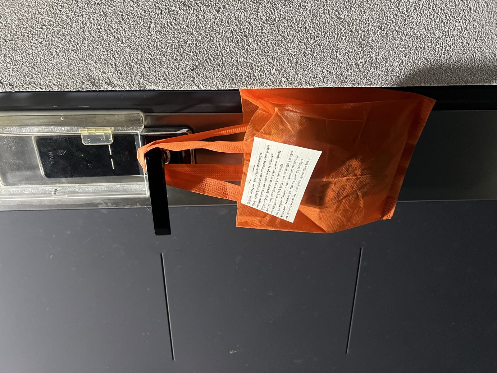

윗집의 층간소음으로 스트레스를 받은 지 벌써 3개월이 넘었다.

원래 소음에 예민한 편은 아니다. 
윗집에서는 새벽에도 웃음소리나 발소리, 가구를 움직이는 소리가 자주 들렸지만 크게 신경 쓰지 않았다. 
그런데 몇 달 전부터 침대가 삐걱거리는 소리가 유독 크게 들리기 시작했다.

다른 소리라면 모르겠는데, 누군가의 사생활을 원치 않게 듣고 있는 기분이랄까. 
하루에도 몇 번씩 반복되니 점점 스트레스가 쌓였다.

처음에는 집주인을 통해 조심스럽게 말씀드렸다. 
잠시 나아지는 듯했지만 얼마 지나지 않아 같은 소리가 들렸고, 한 달쯤 뒤 다시 한번 부탁드렸다.

그런데도 상황은 크게 달라지지 않았다. 이제는 직접 이야기해야겠다고 생각했다.

그렇다고 불쑥 찾아가거나 항의하는 쪽지만 남기고 싶지는 않았다. 
나에게는 불편한 일이지만 상대방은 갑작스러울 수 있으니까.

정중한 쪽지를 쓰고 작은 선물을 함께 준비했다. 발리에서 사 온 과자 두 개였다.

> "안녕하세요! 말씀드리기 조심스러워 작은 간식과 쪽지 남겨요. 지난 번 집주인분을 통해 소음 관련 부탁드렸는데 이후 신경써주시는 게 느껴져 감사했습니다."
> "아마 저희 집에 이렇게 들리는 줄 모르셨을 거 같아요. 저도 뜻하지 않게 사생활을 전해 듣는 기분이라 난감합니다...!"

쪽지에는 그동안 소음 때문에 불편했던 상황과 조심해 주셨으면 하는 마음을 담았다. 
그리고 현관문 손잡이에 과자와 함께 걸어두었다.

<figure>
  
</figure>

**언제나 중요하게 생각하는 것이 있다. 화가 나는 상황에서도 되도록 좋은 마음으로 상대를 대하는 것.** 
내가 먼저 부드럽게 다가가면 상대방도 내 마음을 알아주지 않을까 싶었다.

그리고 오늘, 집에 돌아와 현관문을 열려는데 문손잡이에 종이가방 하나가 걸려 있었다.

윗집에서 보내온 답장이었다. 
손편지와 일본 과자가 들어 있었다. 심지어 로이스 초콜릿까지!

편지에는 소음 때문에 불편을 드려 죄송하다는 말과 앞으로 더 신경 쓰겠다는 내용이 적혀 있었다. 
직접 말씀드리기 조심스러웠을 텐데 이렇게 마음을 전해줘서 감사하다고도 하셨다.

괜히 귀여웠다. 과자까지 챙겨 답장을 주실 줄은 몰랐는데.

그동안 쌓였던 불편한 마음도 조금은 풀렸다. 
서로 얼굴도 모르는 사이지만 이렇게 소통하고 나니 한결 가까워진 기분이었다.

이번 일을 겪으며 다시 한번 느꼈다. 
불편한 상황에서도 꼭 불편한 방식으로 말할 필요는 없다는 것.
내가 먼저 좋은 마음으로 손을 내밀면, 상대방도 좋은 마음으로 대해 줄 수 있다.
