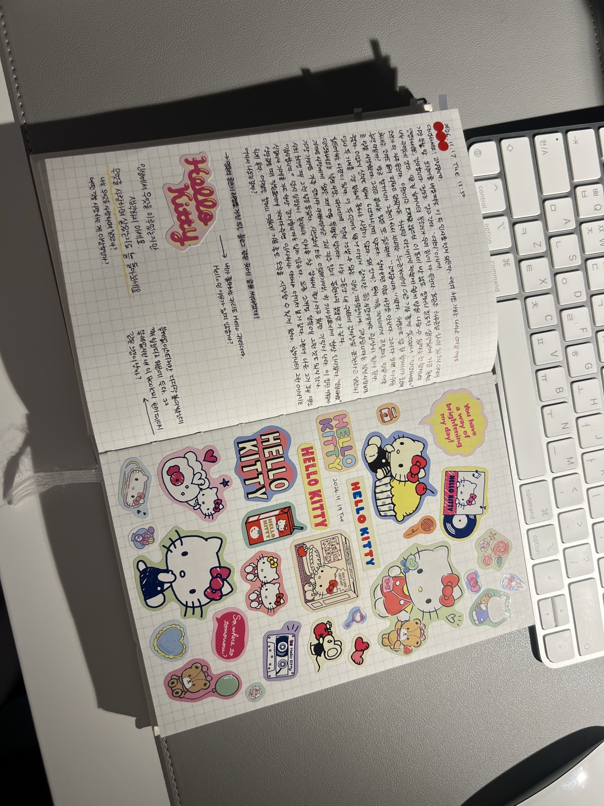
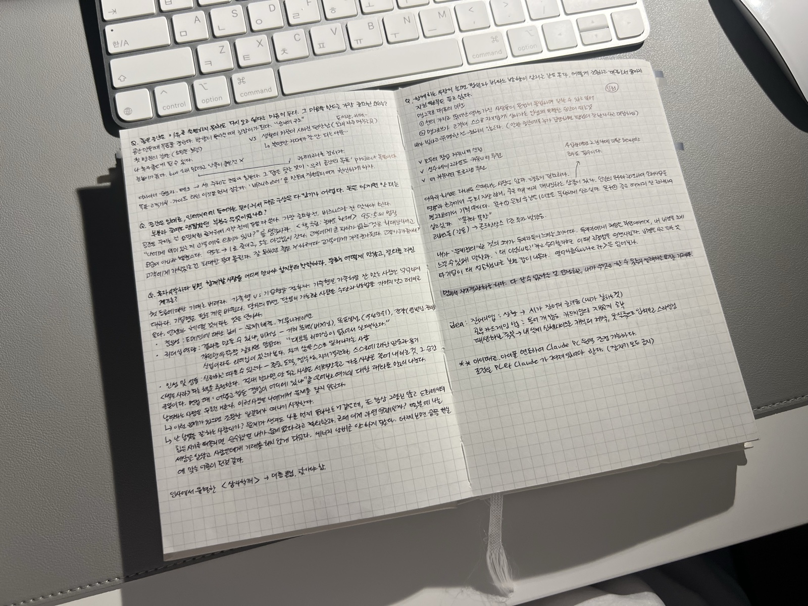

언제나 글쓰기에 대한 갈망이 있었다.

2025년, 2026년. 매년 유명하고 비싼 다이어리를 골라 샀다. 연말이면 다음 해의 목표를 세우며 앞장만 열심히 채웠다.

목표를 세우고 달성하는 데는 꽤 도움이 됐다. 문제는 그 이후였다.

10장 가량을 쓰고 나면 더 이상 채워지지 않았다. 인간은 같은 실패를 반복한다고.. 그럴 줄 알면서도 매년 새로운 다이어리를 샀다.

결국 2026년 다이어리를 마지막으로 결심했다. 나는 다이어리 쓰기와 맞지 않는 사람이구나. 2027년에는 절대 사지 말아야지.

그렇게 다짐하고 교보문고에 갔다. 신년 다이어리 사이에서 모눈 내지의 평범한 공책 하나를 발견했다.

그동안의 실패로 깨달은 것이 두 가지 있었다. 비싼 다이어리는 필요 없다는 것. 그리고 내가 쓰고 싶을 때 마음껏 쓸 수 있도록 정해진 날짜나 양식이 없어야 한다는 것.

그 두 가지 조건에 맞는 공책을 9,900원에 샀다.

처음 사 온 날부터 지금까지 정말 잘 쓰고 있다.

  <figure>
    
  </figure>
  <figure>
    
  </figure>

공개 가능한 페이지로 신중하게 골랐다. 실제로는 매우 빽빽하고 거칠게 쓰여 있다.

가끔 바빠서 며칠씩 건너뛰기도 한다. 하지만 공책에는 미리 적힌 날짜가 없으니 빈 페이지를 보며 부담을 느낄 필요도 없다. 언제든 다시 펼쳐 쓰면 그만이다.

생각해 보면 이전에는 다이어리 하나를 쓰려고 예쁜 펜과 스티커까지 샀다. 글씨도 예쁘게 쓰고 싶었다. 그러다 보니 기록하는 일보다 잘 꾸미고 채우는 일이 더 중요해졌던 것 같다.

나에게 필요한 건 그런 다이어리가 아니었다. 어떤 생각이든 편하게 털어놓을 수 있는 공책 한 권이었다.

나는 자유가 중요하다. 그건 글쓰기에서도 마찬가지였나 보다.

10월 11일에 첫 글을 썼다. 이후 한 달 반 정도가 지났고, 280장짜리 공책의 3분의 1을 채웠다.

이 공책은 때로는 강의 노트가 되고, 아이디어를 정리하는 공간이 된다. 어느 날은 스티커로 가득해지기도 하고, 누구에게도 말하지 못한 이야기를 쏟아내는 곳이 되기도 한다.

머릿속에 떠오르는 생각을 가리지 않고 적다 보면 나조차 몰랐던 마음을 발견할 때가 있다. 복잡했던 감정도 정리되고, 내가 무엇을 중요하게 생각하는 사람인지 조금씩 알아가게 된다.

이 공책을 쓰면서 생긴 가장 큰 변화가 있다.

## 글쓰기가 더 이상 두렵지 않다.

예전에는 늘 글을 쓰고 싶었지만 무엇부터 써야 할지 몰랐다. 특히 내 생각을 다른 사람에게 보여주는 일은 더 어렵게 느껴졌다. 글을 잘 써야 한다는 부담이 있었던 것 같다.

하지만 이 공책에는 잘 쓰려고 애쓰지 않는다. 생각나는 대로 적고, 마음에 들지 않으면 고치면 된다.

말 그대로 내 생각인데, 뭐가 그렇게 두려웠을까.

이제는 내 생각을 글로 남기는 일이 즐겁다. 이렇게 쓰기 시작한 글들이 모여 지금의 '짧은 생각'이라는 공간도 만들어졌다.

무엇이든 쉽게 만들 수 있는 세상이다. 그럴듯한 결과물을 만드는 일은 점점 쉬워지지만, 그 안에 어떤 생각을 담을지는 여전히 중요하다. 내가 직접 경험하고 느낀 것, 그 과정에서 만들어진 나만의 생각은 누구도 대신할 수 없으니까.

9,900원짜리 공책 한 권이 내게 가져온 변화가 생각보다 크다.
